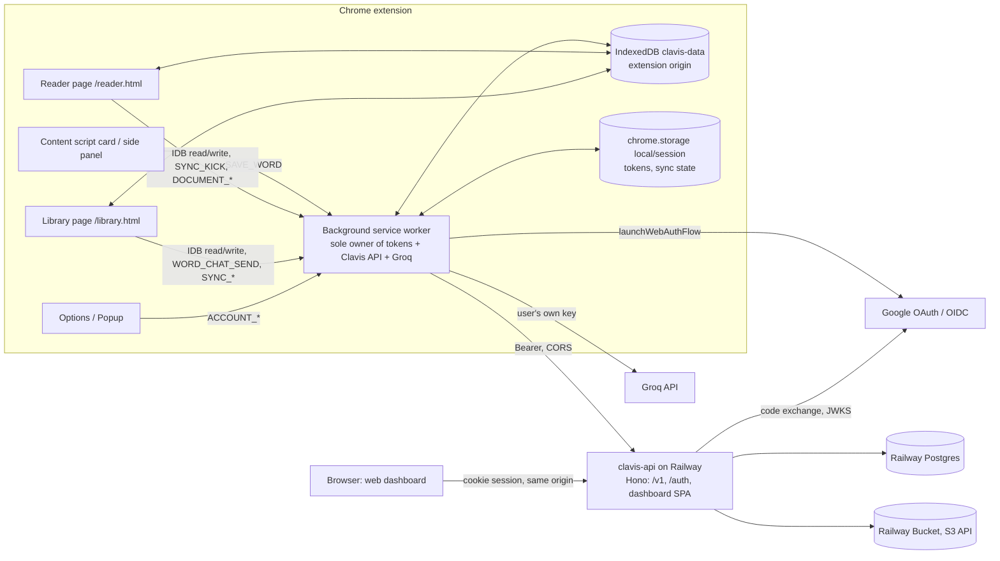

# Clavis Sync: technical design

**Status:** design for implementation, 2026-11-26, branch `clavis-sync`.
**Implements:** product decisions S-01 … S-10 in [decisions/clavis-sync-decisions.md](decisions/clavis-sync-decisions.md).
**Read with:** [architecture.md](architecture.md), especially §3 for permissions and routes, §9 for the secret boundary and §10 for threats. Where this document changes a rule there, §14 lists the change, and architecture.md must be edited before the code.

Conventions: "the background" means the MV3 service worker (`entrypoints/background.ts`). Types are written as TypeScript/zod-style shapes. Every limit in this document is normative for both client and server. All secrets are Railway variables, and none appear here.

---

## 1. Overview

Clavis stays local-first. Signed out (S-01), nothing in this design runs except local saved words and per-word chat. Both are new local features, and neither sends anything off-device except to Groq on an explicit chat send. Signing in with Google (S-02) binds the device's local data to an account and syncs it through a first-party API on Railway (S-03).

### 1.1 Context diagram



The server never calls an AI provider (S-05). The Groq key never leaves the device except in Groq requests (S-09).

---

## 2. Authentication

### 2.1 Google client

- There is one Google OAuth client of type **Web application**. Its ID-token `aud` is the same for both surfaces.
- Authorized redirect URIs: `https://<extension-id>.chromiumapp.org/` for each allowed extension ID (dev unpacked build and Web Store build), plus `<PUBLIC_ORIGIN>/auth/google/callback`.
- Scopes: `openid email profile`. Clavis does not request `access_type=offline` and stores no Google access or refresh tokens.
- The client ID is public and is baked into the extension (`lib/config/constants.ts`, overridable at build time with `WXT_CLAVIS_GOOGLE_CLIENT_ID`). The client secret exists only as a Railway variable.

### 2.2 Extension sign-in (authorization code + PKCE, server-side exchange)

1. The user clicks **Sign in with Google** in Options, the popup or the library. The page sends `ACCOUNT_SIGN_IN` (§7.4).
2. The background generates `codeVerifier` (43–128 chars, 32 random bytes base64url), `codeChallenge = BASE64URL(SHA256(verifier))`, `state` (16 random bytes) and `nonce` (16 random bytes). They are held in SW memory only for the duration of the flow.
3. The background calls `chrome.identity.launchWebAuthFlow({ interactive: true, url })` with this URL:
   `https://accounts.google.com/o/oauth2/v2/auth?client_id=…&redirect_uri=https://<chrome.runtime.id>.chromiumapp.org/&response_type=code&scope=openid%20email%20profile&code_challenge=…&code_challenge_method=S256&state=…&nonce=…&prompt=select_account`
   The redirect URI is always computed from `chrome.identity.getRedirectURL()` and is never hard-coded.
4. The background parses the returned URL. It requires `state` to match exactly and a single `code`, and treats `error` as cancelled or failed.
5. The background calls `POST /v1/auth/extension/google` with `{ code, codeVerifier, redirectUri, nonce }`.
6. The server:
   - checks that `redirectUri` is in the set derived from `ALLOWED_EXTENSION_IDS`, otherwise `400 OAUTH_FAILED`;
   - checks that the request `Origin` is `chrome-extension://<id>` for an allowed id (CORS also enforces this);
   - exchanges the code at Google's token endpoint with `client_secret`, `code_verifier` and `redirect_uri`;
   - verifies the ID token with `jose`, using Google's JWKS (cached) and RS256: `iss ∈ {https://accounts.google.com, accounts.google.com}`, `aud = GOOGLE_CLIENT_ID`, `exp`, `iat` within 5 minutes skew, `nonce = request.nonce` and `email_verified = true`, otherwise `403 EMAIL_NOT_VERIFIED`;
   - upserts the user by `google_sub`, updating `email` and `display_name`;
   - creates a refresh-token family and returns the token pair (§2.3).
7. The background stores the tokens (§2.4) and starts the first-sign-in merge (§4.7).

The local consent step comes before step 1: the sign-in UI shows "Signing in adds this device's saved words, highlights and reading progress to your account" (§4.7). Cancelling means not signing in.

### 2.3 Token model

| Token | Format | Lifetime | Server storage |
| --- | --- | --- | --- |
| Access token | JWT HS256 signed with `TOKEN_SIGNING_SECRET`. Claims `{ iss: PUBLIC_ORIGIN, aud: 'clavis-ext', sub: userId, fam: familyId, iat, exp }` | 15 min | None. Every request checks that family `fam` is not revoked (cached in-process for at most 30 s) |
| Refresh token | 32 random bytes, base64url, prefixed `crt_` | Sliding 30 days, absolute 180 days per family | `refresh_tokens.token_hash = SHA-256(token)` |

- **Rotation:** each `POST /v1/auth/extension/refresh` marks the presented token as `used_at`, inserts its successor in the same family and returns a new pair.
- **Reuse detection:** if a token with `used_at` set is presented:
  - more than 60 s after `used_at`: revoke the whole family (`revoked_at`, reason `reuse`) and return `401 SESSION_REVOKED`;
  - within 60 s (a network retry race): return `401 TOKEN_REUSED` without revoking. A client that already holds a newer token ignores this.
- **Single-flight on the client:** the background keeps one refresh promise in flight, and concurrent callers await it.
- **Revocation:**
  - `POST /v1/auth/extension/logout` revokes the family.
  - `POST /v1/account/logout-all` revokes every family and every web session of the user.
  - Account deletion removes all rows.
- **Key rotation:** the verifier also accepts `TOKEN_SIGNING_SECRET_PREVIOUS` when it is set (one rotation window = 15 min).

### 2.4 Where tokens live in the extension (extends architecture §9 secret boundary)

| Record | Area | Content |
| --- | --- | --- |
| `clavis.account-session` (new STORAGE_KEYS.accountSession) | `chrome.storage.local` (TRUSTED_CONTEXTS) | `{ refreshToken, refreshExpiresAt, userId, email, displayName }` |
| `clavis.account-access` (new STORAGE_KEYS.accountAccess) | `chrome.storage.session` | `{ accessToken, expiresAt }`. Survives SW restarts and is cleared on browser restart |

New normative rules (add to architecture §9 as rules 10–14):

- **R1.** Only background modules under `lib/account/` read or write these two keys. No message route returns a token. `ACCOUNT_GET_STATUS` returns `{ signedIn, email, displayName, sync }` only. Enforce this with an ESLint `no-restricted-imports`/`no-restricted-syntax` rule or a unit test. The rule allows only `lib/account/**` to reference `STORAGE_KEYS.accountSession` or `accountAccess`.
- **R2.** Only the background calls the Clavis API. Extension pages (reader, library, options) never `fetch` the API. PDF bytes cross into or out of the background through IndexedDB (§6.6).
- **R3.** Token reads `await whenStorageLockedDown()` like the Groq key (lib/security/storage-lockdown.ts). Deleting tokens is always allowed.
- **R4.** Tokens and the Groq key are never in the same request. The Groq key is never sent to the Clavis API (S-09), and Clavis tokens are never sent to Groq. Requests go only to the configured API origin, over `https:`. The single exception is a non-store dev build pointing at `http://localhost`.
- **R5.** Clear-all-data (`CLEAR_ALL_DATA`) signs out first (best effort, keepLocalCopy=false), then clears storage and deletes the IDB database.

### 2.5 Dashboard sign-in (server-side redirect)

1. `GET /auth/google/start[?reauth=1]`:
   - The server creates `state`, `nonce` and a PKCE verifier.
   - It stores them in a `__Host-clavis_oauth` cookie: AES-GCM sealed with `STATE_COOKIE_SECRET`, `HttpOnly; Secure; SameSite=Lax; Path=/; Max-Age=600`.
   - It returns a 302 to Google with `redirect_uri=<PUBLIC_ORIGIN>/auth/google/callback`. With `reauth=1` it adds `prompt=login&max_age=0`.
2. `GET /auth/google/callback?code&state`:
   - Unseal the cookie, compare `state` in constant time, exchange the code (secret + verifier) and verify the ID token as in §2.2.
   - Upsert the user and create a `web_sessions` row.
   - Set `__Host-clavis_session=<32 random bytes>` with `HttpOnly; Secure; SameSite=Lax; Path=/`. The row stores only the SHA-256 hash.
   - Clear the oauth cookie and **302 to the fixed path `/`**. There is no `returnTo` parameter, so there is no open redirect.
3. Session lifetime: 7 days idle (sliding `last_seen_at`) and 30 days absolute. `authenticated_at` records the time of the last forced Google sign-in (`?reauth=1`, bound to Google's `auth_time`; epoch 0 after an ordinary sign-in), for re-auth (§8.4).
4. CSRF:
   - (a) `SameSite=Lax`.
   - (b) Every cookie-authenticated non-GET request must carry an `Origin` header exactly equal to `PUBLIC_ORIGIN`.
   - (c) Every such request must carry `X-CSRF-Token` equal to the session's `csrf_token`, returned by `GET /v1/session` and compared in constant time.
   - (d) JSON bodies require `Content-Type: application/json`.
   - Otherwise the response is `403 CSRF_FAILED`.
   - GET handlers never change state.

### 2.6 Configuration (no hard-coded IDs)

- `ALLOWED_EXTENSION_IDS` is a comma-separated list. The server derives:
  - `ALLOWED_EXTENSION_ORIGINS = chrome-extension://<id>`;
  - `ALLOWED_EXTENSION_REDIRECTS = https://<id>.chromiumapp.org/`.
- CORS applies only to Bearer routes. Allowed origins are exactly `ALLOWED_EXTENSION_ORIGINS`, `Access-Control-Allow-Credentials` is not set, allowed headers are `Authorization, Content-Type, Idempotency-Key`, and max-age is 600.
- The dashboard is same-origin and needs no CORS.
- The extension reads its own redirect URI at runtime, so the dev unpacked ID (pinned by the manifest `key`) and the store ID both work once both IDs are listed in the env var and in Google's redirect URIs.

---

## 3. Postgres schema

Tool: **Drizzle ORM + drizzle-kit** (`pg` driver). The schema lives in `server/src/db/schema.ts`. Generated SQL migrations are reviewed and committed in `server/migrations/`, and they are forward-only. They run in Railway `preDeployCommand` via `drizzle-orm/node-postgres/migrator`. Constraints that Drizzle cannot express are added as raw SQL in the migration files. Drizzle is chosen because one tool gives typed queries, check constraints, partial indexes and raw-SQL escape hatches for the quota update.

All timestamps are `timestamptz`. Every user-owned table has `user_id uuid NOT NULL REFERENCES users(id) ON DELETE CASCADE` as the first key column. All lookups include `user_id` from the auth context, and `user_id` is never taken from the client.

### 3.1 Tables

```sql
-- Extension: pgcrypto not needed (gen_random_uuid is core in PG13+).

CREATE TABLE users (
  id                     uuid PRIMARY KEY DEFAULT gen_random_uuid(),
  google_sub             text NOT NULL UNIQUE CHECK (length(google_sub) BETWEEN 1 AND 255),
  email                  text NOT NULL CHECK (length(email) <= 320),
  display_name           text CHECK (length(display_name) <= 200),
  created_at             timestamptz NOT NULL DEFAULT now(),
  updated_at             timestamptz NOT NULL DEFAULT now(),
  change_seq             bigint NOT NULL DEFAULT 0,          -- per-user sync sequence (§4.2)
  tombstone_floor_seq    bigint NOT NULL DEFAULT 0,          -- highest seq of a purged tombstone
  storage_quota_bytes    bigint NOT NULL DEFAULT 104857600,  -- 100 MiB (S-06)
  storage_used_bytes     bigint NOT NULL DEFAULT 0,
  storage_reserved_bytes bigint NOT NULL DEFAULT 0,
  CONSTRAINT storage_nonneg CHECK (storage_used_bytes >= 0 AND storage_reserved_bytes >= 0),
  CONSTRAINT storage_within_quota CHECK (storage_used_bytes + storage_reserved_bytes <= storage_quota_bytes)
);

CREATE TABLE refresh_tokens (
  id                 uuid PRIMARY KEY DEFAULT gen_random_uuid(),
  user_id            uuid NOT NULL REFERENCES users(id) ON DELETE CASCADE,
  family_id          uuid NOT NULL,
  token_hash         bytea NOT NULL UNIQUE,                 -- SHA-256
  created_at         timestamptz NOT NULL DEFAULT now(),
  expires_at         timestamptz NOT NULL,                  -- sliding 30 d
  family_expires_at  timestamptz NOT NULL,                  -- absolute 180 d
  used_at            timestamptz,
  revoked_at         timestamptz,
  revoked_reason     text CHECK (revoked_reason IN ('logout','logout_all','reuse','expired'))
);
CREATE INDEX refresh_tokens_family ON refresh_tokens (family_id);
CREATE INDEX refresh_tokens_user ON refresh_tokens (user_id);

CREATE TABLE web_sessions (
  id                uuid PRIMARY KEY DEFAULT gen_random_uuid(),
  user_id           uuid NOT NULL REFERENCES users(id) ON DELETE CASCADE,
  session_hash      bytea NOT NULL UNIQUE,
  csrf_token        text NOT NULL,                          -- random, not a credential on its own
  created_at        timestamptz NOT NULL DEFAULT now(),
  last_seen_at      timestamptz NOT NULL DEFAULT now(),
  authenticated_at  timestamptz NOT NULL,                   -- last forced Google sign-in (re-auth window); epoch 0 otherwise
  expires_at        timestamptz NOT NULL,                   -- absolute 30 d
  revoked_at        timestamptz
);
CREATE INDEX web_sessions_user ON web_sessions (user_id);

CREATE TABLE saved_words (
  user_id             uuid NOT NULL REFERENCES users(id) ON DELETE CASCADE,
  word_key            char(64) NOT NULL CHECK (word_key ~ '^[0-9a-f]{64}$'),  -- SHA-256(normalize(text)) (§4.5)
  text                text NOT NULL CHECK (length(text) BETWEEN 1 AND 200),
  language            text CHECK (length(language) <= 35),
  meaning             jsonb NOT NULL CHECK (octet_length(meaning::text) <= 16384),  -- SavedMeaning (§5.2)
  context_before      text CHECK (length(context_before) <= 1000),
  context_after       text CHECK (length(context_after) <= 1000),
  source_kind         text NOT NULL CHECK (source_kind IN ('webpage','pdf')),
  source_url          text CHECK (length(source_url) <= 2048),     -- origin+path only, no query/fragment
  source_title        text CHECK (length(source_title) <= 300),
  pdf_fingerprint     char(64) CHECK (pdf_fingerprint ~ '^[0-9a-f]{64}$'),
  pdf_page            integer CHECK (pdf_page BETWEEN 1 AND 5000),
  created_at          timestamptz NOT NULL,                        -- client time of first save
  client_modified_at  timestamptz NOT NULL,                        -- LWW key (§4.4)
  server_modified_at  timestamptz NOT NULL DEFAULT now(),
  seq                 bigint NOT NULL,
  deleted_at          timestamptz,
  PRIMARY KEY (user_id, word_key),
  CHECK (source_kind = 'pdf' OR (pdf_fingerprint IS NULL AND pdf_page IS NULL))
);
CREATE INDEX saved_words_seq ON saved_words (user_id, seq);
CREATE INDEX saved_words_list ON saved_words (user_id, created_at DESC, word_key) WHERE deleted_at IS NULL;

CREATE TABLE word_chat_messages (
  id                 uuid NOT NULL,                       -- client-generated UUIDv4
  user_id            uuid NOT NULL,
  word_key           char(64) NOT NULL,
  role               text NOT NULL CHECK (role IN ('user','assistant')),
  content            text NOT NULL CHECK (length(content) BETWEEN 1 AND 4000),
  model              text CHECK (length(model) <= 128),   -- assistant only
  created_at         timestamptz NOT NULL,                -- client time; ordering within a word
  seq                bigint NOT NULL,
  PRIMARY KEY (user_id, id),
  FOREIGN KEY (user_id, word_key) REFERENCES saved_words (user_id, word_key) ON DELETE CASCADE
);
CREATE INDEX chat_by_word ON word_chat_messages (user_id, word_key, created_at, id);
CREATE INDEX chat_seq ON word_chat_messages (user_id, seq);
-- Messages are immutable. Deleting a word hard-deletes its messages in the same transaction
-- (clients drop local messages when they receive the word tombstone).

CREATE TABLE documents (
  user_id             uuid NOT NULL REFERENCES users(id) ON DELETE CASCADE,
  fingerprint         char(64) NOT NULL CHECK (fingerprint ~ '^[0-9a-f]{64}$'),  -- SHA-256 of file bytes
  title               text CHECK (length(title) <= 300),
  page_count          integer CHECK (page_count BETWEEN 1 AND 5000),
  last_page           integer CHECK (last_page BETWEEN 1 AND 5000),
  page_offset         real CHECK (page_offset >= 0 AND page_offset <= 1),
  file_bytes          bigint CHECK (file_bytes > 0),        -- client-reported size of the local file (info)
  client_modified_at  timestamptz NOT NULL,
  server_modified_at  timestamptz NOT NULL DEFAULT now(),
  seq                 bigint NOT NULL,
  deleted_at          timestamptz,
  -- server-owned storage fields (never accepted from sync push)
  storage_state       text NOT NULL DEFAULT 'none' CHECK (storage_state IN ('none','stored')),
  object_key          text,
  stored_bytes        bigint CHECK (stored_bytes BETWEEN 1 AND 15728640),  -- 15 MiB (S-06)
  stored_at           timestamptz,
  PRIMARY KEY (user_id, fingerprint),
  CHECK ((storage_state = 'stored') = (object_key IS NOT NULL AND stored_bytes IS NOT NULL))
);
CREATE INDEX documents_seq ON documents (user_id, seq);
CREATE INDEX documents_recent ON documents (user_id, client_modified_at DESC) WHERE deleted_at IS NULL;

CREATE TABLE highlights (
  user_id             uuid NOT NULL,
  id                  uuid NOT NULL,                        -- the existing ReaderHighlight.id
  fingerprint         char(64) NOT NULL,
  page                integer NOT NULL CHECK (page BETWEEN 1 AND 5000),
  start_offset        integer NOT NULL CHECK (start_offset BETWEEN 0 AND 10000000),
  end_offset          integer NOT NULL CHECK (end_offset BETWEEN 1 AND 10000000),
  color               text NOT NULL CHECK (color IN ('yellow','green','blue','pink')),
  created_at          timestamptz NOT NULL,
  client_modified_at  timestamptz NOT NULL,
  server_modified_at  timestamptz NOT NULL DEFAULT now(),
  seq                 bigint NOT NULL,
  deleted_at          timestamptz,
  PRIMARY KEY (user_id, id),
  FOREIGN KEY (user_id, fingerprint) REFERENCES documents (user_id, fingerprint) ON DELETE CASCADE,
  CHECK (end_offset > start_offset)
);
CREATE INDEX highlights_seq ON highlights (user_id, seq);
CREATE INDEX highlights_doc ON highlights (user_id, fingerprint) WHERE deleted_at IS NULL;

CREATE TABLE uploads (                                       -- quota reservations (§6.2)
  id             uuid PRIMARY KEY DEFAULT gen_random_uuid(),
  user_id        uuid NOT NULL REFERENCES users(id) ON DELETE CASCADE,
  fingerprint    char(64) NOT NULL,
  reserved_bytes bigint NOT NULL CHECK (reserved_bytes BETWEEN 1 AND 15728640),
  object_key     text NOT NULL,
  status         text NOT NULL CHECK (status IN ('pending','completed','aborted','expired')),
  created_at     timestamptz NOT NULL DEFAULT now(),
  expires_at     timestamptz NOT NULL,                       -- created_at + 15 min
  finished_at    timestamptz
);
CREATE UNIQUE INDEX uploads_one_pending ON uploads (user_id, fingerprint) WHERE status = 'pending';
CREATE INDEX uploads_expiry ON uploads (expires_at) WHERE status = 'pending';

CREATE TABLE object_deletions (                              -- durable bucket-delete jobs; no FK (outlives users)
  id              bigserial PRIMARY KEY,
  object_key      text,                                      -- exactly one of key / prefix
  object_prefix   text,
  attempts        integer NOT NULL DEFAULT 0,
  next_attempt_at timestamptz NOT NULL DEFAULT now(),
  created_at      timestamptz NOT NULL DEFAULT now(),
  CHECK ((object_key IS NULL) <> (object_prefix IS NULL))
);

CREATE TABLE idempotency_keys (
  user_id       uuid NOT NULL REFERENCES users(id) ON DELETE CASCADE,
  key           uuid NOT NULL,
  request_hash  bytea NOT NULL,                              -- SHA-256 of canonical request body
  response      jsonb NOT NULL,
  created_at    timestamptz NOT NULL DEFAULT now(),
  PRIMARY KEY (user_id, key)
);
```

### 3.2 Quota and count accounting

| Limit | Value | Enforced |
| --- | --- | --- |
| Stored PDF size | ≤ 15 MiB (15,728,640 B) per file | Streaming byte counter plus `stored_bytes` CHECK |
| Stored PDF total | ≤ 100 MiB per account | `storage_within_quota` CHECK plus conditional reservation (§6.2) |
| Saved words (live) | ≤ 5,000 | Push transaction under the user row lock |
| Chat messages per word | ≤ 200 | Same |
| Documents (live) | ≤ 2,000 | Same |
| Highlights per document (live) | ≤ 200 (existing `MAX_HIGHLIGHTS_PER_DOCUMENT`) | Same |

The counts are checked inside the transaction that holds the user row lock (§4.2), so concurrent pushes cannot exceed them. A change that would exceed a limit gets an item result `rejected / LIMIT_EXCEEDED`.

### 3.3 Tombstones and retention

- Soft delete means setting `deleted_at` and taking a new `seq`. The tombstone row keeps only key fields: the purge job nulls the content columns (`meaning`, context, URL, title) **at deletion time**, so deleted content is not retained for 90 days.
- A daily job hard-deletes tombstones whose `deleted_at` is older than 90 days, and sets `users.tombstone_floor_seq = GREATEST(floor, max(seq) purged)`.
- `idempotency_keys` older than 24 h, refresh tokens 7 days past expiry or revocation, web sessions 7 days past expiry, and `uploads` rows older than 7 days are purged by the same job.

---

## 4. Sync protocol

### 4.1 Local model (extension)

The new IndexedDB database is `clavis-data` (version 1) on the extension origin. Content scripts cannot open it because they run in the page origin, which is the IDB equivalent of TRUSTED_CONTEXTS. It is a hand-written wrapper in `lib/data/db.ts` with no `idb` dependency, to protect the reader bundle budget.

| Store | Key | Value (plus sync fields) |
| --- | --- | --- |
| `words` | `wordKey` | `LocalWord` = the WordData of §5.2 |
| `chat` | `id`; index `byWord` = [wordKey, createdAt] | `LocalChatMessage` |
| `documents` | `fingerprint`; index `byRecent` | title, pageCount, lastPage, pageOffset, fileBytes, storageState (server-owned, read-only locally) |
| `highlights` | `id`; index `byDoc` = fingerprint | the existing `ReaderHighlight` fields plus fingerprint |
| `fileHandoff` | `fingerprint` | `{ blob: Blob, direction: 'upload' \| 'download', createdAt }` (§6.6) |

Sync fields on every record in `words`, `chat`, `documents` and `highlights`:

```ts
interface SyncFields {
  clientModifiedAt: number; // ms epoch, set on every local edit
  seq: number | null;       // last server seq seen for this record; null = never synced
  dirty: 0 | 1;             // indexed; 1 = needs push (only maintained while signed in, see 4.7)
  rev: number;              // increments on each local edit; push clears dirty only if rev unchanged
  deleted: 0 | 1;           // local tombstone awaiting push (signed out: records are deleted directly)
}
```

There is no separate outbox: dirty flags make pushes idempotent and coalesce edits. The writers are:

- the reader: highlights and progress;
- the library: word delete;
- the background: word save, chat messages and server-applied changes.

Writers use one IDB transaction per edit. After a write, an extension page sends `SYNC_KICK`, a fire-and-forget message that wakes the SW. Pages learn about remote changes through a `BroadcastChannel('clavis-data')` message `{ stores: string[] }` that the background posts after applying a pull.

Non-record sync state goes in `chrome.storage.local` key `clavis.sync-state` (non-secret):
`{ accountId, cursor: string, lastPushAt, lastPullAt, lastError?: ErrorCode, deviceId: uuid }`.

### 4.2 Server sequence and cursor

- Every write transaction for a user starts with `SELECT change_seq FROM users WHERE id=$1 FOR UPDATE`. It assigns `seq = change_seq + 1, +2, …` to each row it writes and finally runs `UPDATE users SET change_seq = <last>`.
- Because the user row lock is held until commit, each user's commits are serialized in seq order. A pull that sees seq N therefore never later finds an uncommitted seq < N. This is the classic flaw of a global `bigserial` cursor, and the per-user lock avoids it.
- The same lock serializes quota and count checks (§3.2, §6.2).
- The cursor is the decimal string of the highest seq the client has applied. `"0"` means "from the beginning".

### 4.3 Push

`POST /v1/sync/push` (Bearer only), with header `Idempotency-Key: <uuid>`:

- Each change in the batch is applied in order.
- Item failures do not abort the batch, except that an internal error rolls back the whole transaction and returns 5xx.
- The idempotency record is written in the same transaction. Replaying the same key with the same body hash returns the stored response; a different body returns `409 IDEMPOTENCY_MISMATCH`.

### 4.4 Conflict rule

**Last-writer-wins per record, on `clientModifiedAt`:**

- On receipt the server clamps `clientModifiedAt` to `min(clientModifiedAt, server_now + 60 s)`. Values older than 2020-01-01 are rejected.
- **Apply** if there is no row or `incoming.clientModifiedAt > stored.client_modified_at`. A delete is a change like any other: a tombstone wins only if it is newer, and a newer upsert resurrects a tombstoned row.
- **Equal or older**: the result is `stale` and carries the current server record. The client overwrites its local copy and clears `dirty`.
- The server cursor uses only `seq`. Client clocks decide only between two versions of one record.
- Exceptions:
  - chat messages are insert-only, so a duplicate id is `applied` when identical and `rejected / CONFLICT` otherwise;
  - document storage fields are server-owned and never in push.
- Cascades:
  - word delete hard-deletes that word's messages;
  - document delete tombstones its live highlights (each with a seq) and, if stored, removes the file (§6.4);
  - a highlight or progress upsert for an unknown or tombstoned document creates or resurrects a document stub with `title = null`.

### 4.5 Saved-word identity

`wordKey = hex(SHA-256(UTF-8(normalize(text))))`, where

```ts
normalize = (t: string) => t.normalize('NFKC').trim().replace(/\s+/gu, ' ').toLowerCase();
```

The function lives in `shared/api-contract/words.ts`, used by both sides. The server recomputes the key and rejects a mismatch (`VALIDATION_FAILED`). Two devices saving the same word offline produce the same key and converge through LWW with no merge step. Re-saving an existing word replaces its meaning, context and source (newest wins) and keeps its chat.

### 4.6 Pull

`GET /v1/sync/pull?cursor=<seq>&limit=<1..1000, default 500>`:

- returns the union of rows from the four record tables with `seq > cursor`, ordered by seq;
- `nextCursor` is the last returned seq;
- `hasMore` is set when the limit was reached.

If `cursor > 0 AND cursor < tombstone_floor_seq`, the server returns `410 CURSOR_EXPIRED`. The client then runs a **full resync**:

1. pull from `0` until `hasMore = false`, recording every key seen;
2. delete local records that are non-dirty, have `seq != null` and were not seen;
3. push dirty records as usual.

Client application of pulled changes:

- skip if the local record is dirty and its `clientModifiedAt` is newer; it will be pushed and LWW decides;
- otherwise overwrite;
- a tombstone deletes the record locally; a word tombstone also deletes the word's messages; a document tombstone also deletes its highlights.
- **children may arrive before their parent.** Rows keep their own seq, so a chat message or highlight can be pulled in an earlier page than its word or document (for example after the parent was re-saved). Apply children even when the parent is not local yet, and reconcile orphans only after `hasMore = false`. Never drop a pulled child for a missing parent mid-pull: once the cursor moves past it, it is gone.
- **chat after a word delete and re-save.** A word delete hard-deletes its messages on the server without telling other devices. When a pull brings a live word, drop that word's local messages that are not dirty and have `seq` ≤ the word's seq but were not seen in this pull or any later one (in practice, during full resync step 2 and after a word the client had seen deleted).

Client push results (confirmed by the server's convergence test): `stale` → overwrite with `current` and clear `dirty`; `rejected` with `NOT_FOUND` → drop the local record (its parent is gone on the server); `LIMIT_EXCEEDED` → keep the record as local-only (clear `dirty`, `seq` stays null, count it) so the user never loses data to a quota; other `rejected` → keep local, clear `dirty`, count it.

Local document delete (signed in) must tombstone each of the document's highlights locally (each dirty), not just drop them: if the server answers `stale` for the document delete because another device edited it later, it does not cascade, and dropped highlights would stay live on the server.

### 4.7 Client scheduling, first sign-in, sign-out, account switching

**Triggers.** The background owns all pushes and pulls in `lib/sync/engine.ts`:

- push is debounced 5 s after `SYNC_KICK` (progress updates coalesce);
- pull runs after each push, on `runtime.onStartup`, on `SYNC_NOW`, when the library or reader opens (`SYNC_KICK { pull: true }`), and from a `chrome.alarms` alarm `clavis-sync` every 30 min while signed in;
- failures back off exponentially (1, 2, 4 … 60 min) through a one-shot alarm, and `429`/`503` honour `Retry-After`;
- one engine run at a time, guarded by a `navigator.locks` lock `clavis-sync`.

**Push batch.** Up to 200 dirty records ordered by store: documents → highlights → words → chat. After a response:

- `applied`: set `seq` and clear `dirty` if `rev` is unchanged;
- `stale`: adopt the server record;
- `rejected`: clear `dirty` and keep local, then surface the count in the sync status. `LIMIT_EXCEEDED` keeps the record local-only.

**First sign-in merge (S-01, existing highlights).**

1. The sign-in UI states that existing local data will be added to the account. Signing in is the consent.
2. After tokens are stored: mark every record in the four stores `dirty=1`, `seq=null` and keep `clientModifiedAt`.
3. Set `sync-state = { accountId, cursor: '0' }`.
4. Push everything, then pull from 0.
5. Local highlights migrated from `clavis.reader-highlights` (§7.3) are ordinary records here.
6. Highlight UUIDs are unique, so there are no duplicates. Words converge by key, and documents by LWW on progress.

**Sign-out** (`ACCOUNT_SIGN_OUT { keepLocalCopy: boolean }`, default `false` in the UI):

1. Attempt a final push with a 10 s budget. If dirty records remain, the UI must already have shown "N changes are not synced yet" (from `ACCOUNT_GET_STATUS.sync.pending`) before confirming.
2. `POST /v1/auth/extension/logout` (best effort), then delete both token records and `clavis.sync-state`.
3. If `keepLocalCopy` is set: drop local tombstones, set `dirty=0` and `seq=null` everywhere, and keep the data as unbound local data.
   Otherwise: delete all records in `words`, `chat`, `documents`, `highlights` and `fileHandoff`. The cloud copy is kept.
4. Broadcast `{ stores: all }`.

**Multi-account.** A device is bound to at most one account at a time. Switching is sign-out followed by sign-in. With the default sign-out the new account starts clean; with "Keep a copy" the kept data is merged into the next account after the §4.7 consent. Records never carry account ids.

**Server-side revocation** (`SESSION_REVOKED`, `UNAUTHENTICATED` after a failed refresh): the client signs out locally with `keepLocalCopy = true` so nothing is silently lost, and shows a notice. This also covers account deletion from the dashboard; the dashboard's deletion copy says device copies must be removed on each device.

**Groq key (S-09).** The sync engine reads only the IDB stores above. Push payloads are built only from strict zod schemas (`shared/api-contract`), which have no field that could carry a key. A unit test asserts that the serialized push never contains the stored key value.

---

## 5. Shared API contract

The contract lives in `shared/api-contract/` (new; imports only `zod`). It is the single source for the extension sync client, the server validators and the dashboard. Error envelope for every non-2xx response:

```ts
type ApiError = {
  error: {
    code: ErrorCode;
    message: string;        // English, diagnostic; UIs map by code
    retryAfterMs?: number;  // with RATE_LIMITED / UNAVAILABLE
    details?: { field?: string; limit?: number };
  };
};
type ErrorCode =
  | 'UNAUTHENTICATED' | 'TOKEN_EXPIRED' | 'TOKEN_REUSED' | 'SESSION_REVOKED'
  | 'FORBIDDEN' | 'CSRF_FAILED' | 'REAUTH_REQUIRED' | 'OAUTH_FAILED' | 'EMAIL_NOT_VERIFIED'
  | 'NOT_FOUND' | 'VALIDATION_FAILED' | 'PAYLOAD_TOO_LARGE' | 'UNSUPPORTED_MEDIA_TYPE'
  | 'FILE_TOO_LARGE' | 'QUOTA_EXCEEDED' | 'NOT_A_PDF' | 'FINGERPRINT_MISMATCH'
  | 'UPLOAD_IN_PROGRESS' | 'LIMIT_EXCEEDED' | 'CURSOR_EXPIRED' | 'IDEMPOTENCY_MISMATCH'
  | 'CONFLICT' | 'RATE_LIMITED' | 'INTERNAL' | 'UNAVAILABLE';
```

HTTP status mapping:

| Status | Codes |
| --- | --- |
| 400 | VALIDATION_FAILED, OAUTH_FAILED |
| 401 | UNAUTHENTICATED, TOKEN_EXPIRED, TOKEN_REUSED, SESSION_REVOKED |
| 403 | FORBIDDEN, CSRF_FAILED, REAUTH_REQUIRED, EMAIL_NOT_VERIFIED |
| 404 | NOT_FOUND |
| 409 | CONFLICT, UPLOAD_IN_PROGRESS, IDEMPOTENCY_MISMATCH |
| 410 | CURSOR_EXPIRED |
| 413 | PAYLOAD_TOO_LARGE, FILE_TOO_LARGE |
| 415 | UNSUPPORTED_MEDIA_TYPE |
| 422 | NOT_A_PDF, FINGERPRINT_MISMATCH, LIMIT_EXCEEDED, QUOTA_EXCEEDED |
| 429 | RATE_LIMITED |
| 500 | INTERNAL |
| 503 | UNAVAILABLE |

### 5.1 Primitives

```ts
const Hex64 = z.string().regex(/^[0-9a-f]{64}$/);
const Uuid = z.uuid();
const EpochMs = z.number().int().min(1577836800000);  // >= 2020-01-01
const Seq = z.string().regex(/^\d{1,19}$/);            // bigint as string
const Text = (max: number) => z.string().max(max);    // plain text only; UIs render as text nodes (D-10)
```

### 5.2 Record shapes

```ts
const SavedMeaning = z.strictObject({        // subset of ExplainResult (lib/contracts/explain.ts), core tab
  title: Text(120), summary: Text(600),
  contextualMeaning: Text(800).optional(), definition: Text(600).optional(),
  examples: z.array(z.strictObject({ sentence: Text(300), note: Text(200).optional() })).max(2).optional(),
  caveat: Text(400).optional(),
  model: Text(128),
});
const WordSource = z.discriminatedUnion('kind', [
  z.strictObject({ kind: z.literal('webpage'), url: Text(2048).nullable(), title: Text(300).nullable() }),
  z.strictObject({ kind: z.literal('pdf'), fingerprint: Hex64.nullable(), title: Text(300).nullable(),
                   page: z.number().int().min(1).max(5000) }),
]);
const WordData = z.strictObject({
  text: z.string().trim().min(1).max(200),
  language: Text(35).optional(),
  meaning: SavedMeaning,
  contextBefore: Text(1000).optional(), contextAfter: Text(1000).optional(),  // combined <= 1000
  source: WordSource,
  createdAt: EpochMs,
});
const ChatData = z.strictObject({
  wordKey: Hex64, role: z.enum(['user', 'assistant']),
  content: z.string().min(1).max(4000),   // user messages additionally <= 2000 (checked by role)
  model: Text(128).optional(),            // required iff role = 'assistant'
  createdAt: EpochMs,
});
const DocumentData = z.strictObject({
  title: Text(300).nullable(), pageCount: z.number().int().min(1).max(5000).nullable(),
  lastPage: z.number().int().min(1).max(5000).nullable(),
  pageOffset: z.number().min(0).max(1).nullable(),
  fileBytes: z.number().int().positive().max(104857600).nullable(),
});
const HighlightData = z.strictObject({
  fingerprint: Hex64, page: z.number().int().min(1).max(5000),
  start: z.number().int().min(0).max(10_000_000), end: z.number().int().min(1).max(10_000_000),
  color: z.enum(['yellow', 'green', 'blue', 'pink']), createdAt: EpochMs,
}); // refine: end > start
```

### 5.3 Sync messages

```ts
const PushChange = z.discriminatedUnion('kind', [
  z.strictObject({ kind: z.literal('word'), op: z.literal('upsert'), key: Hex64, clientModifiedAt: EpochMs, data: WordData }),
  z.strictObject({ kind: z.literal('word'), op: z.literal('delete'), key: Hex64, clientModifiedAt: EpochMs }),
  z.strictObject({ kind: z.literal('chat'), op: z.literal('insert'), id: Uuid, data: ChatData }),
  z.strictObject({ kind: z.literal('document'), op: z.literal('upsert'), key: Hex64, clientModifiedAt: EpochMs, data: DocumentData }),
  z.strictObject({ kind: z.literal('document'), op: z.literal('delete'), key: Hex64, clientModifiedAt: EpochMs }),
  z.strictObject({ kind: z.literal('highlight'), op: z.literal('upsert'), id: Uuid, clientModifiedAt: EpochMs, data: HighlightData }),
  z.strictObject({ kind: z.literal('highlight'), op: z.literal('delete'), id: Uuid, fingerprint: Hex64, clientModifiedAt: EpochMs }),
]);
// Discriminate on `${kind}:${op}` in implementation (zod discriminatedUnion needs a unique key; use z.union + refine or a combined `type` field).
const PushRequest = z.strictObject({ changes: z.array(PushChange).min(1).max(200) });  // body <= 512 KiB
const PushResult = z.strictObject({
  index: z.number().int(),
  status: z.enum(['applied', 'stale', 'rejected']),
  seq: Seq.optional(),                    // applied
  current: ServerChange.optional(),       // stale: the server's record
  code: z.enum(['LIMIT_EXCEEDED', 'VALIDATION_FAILED', 'NOT_FOUND', 'CONFLICT']).optional(),  // rejected
});
const PushResponse = z.strictObject({ results: z.array(PushResult), serverTime: EpochMs });

const ServerChange = z.discriminatedUnion('kind', [
  z.strictObject({ kind: z.literal('word'), key: Hex64, seq: Seq, deleted: z.boolean(), clientModifiedAt: EpochMs, data: WordData.nullable() }),
  z.strictObject({ kind: z.literal('chat'), id: Uuid, seq: Seq, data: ChatData }),
  z.strictObject({ kind: z.literal('document'), key: Hex64, seq: Seq, deleted: z.boolean(), clientModifiedAt: EpochMs,
                   data: DocumentData.nullable(),
                   storage: z.strictObject({ state: z.enum(['none', 'stored']), bytes: z.number().int().nullable() }) }),
  z.strictObject({ kind: z.literal('highlight'), id: Uuid, seq: Seq, deleted: z.boolean(), clientModifiedAt: EpochMs,
                   fingerprint: Hex64, data: HighlightData.nullable() }),
]);
const PullResponse = z.strictObject({ changes: z.array(ServerChange), nextCursor: Seq, hasMore: z.boolean() });
```

`ChatData` for a missing or tombstoned word is rejected with `NOT_FOUND`, and the client deletes the orphaned message locally.

### 5.4 Endpoints

Auth column:

- `B`: Bearer only (extension).
- `C`: cookie session (dashboard; CSRF rules of §2.5 on non-GET).
- `B|C`: either.
- `—`: public.

Pagination is keyset: `?cursor=<opaque base64url of (sortKey,id)>&limit=1..100 (default 50)`, returning `{ items, nextCursor: string | null }`.

| Method & path | Auth | Request | 2xx response | Rate limit |
| --- | --- | --- | --- | --- |
| GET `/healthz` | — | — | 200 `{status:'ok'}` (process alive) | — |
| GET `/readyz` | — | — | 200 `{status:'ok'}` after DB `SELECT 1`; 503 otherwise | — |
| GET `/v1/meta` | — | — | `{ apiVersion: 1, limits: { maxFileBytes, quotaBytes, maxWords, maxMessagesPerWord, maxDocuments, maxHighlightsPerDocument, maxPushChanges, maxPullLimit } }` | 60/min/IP |
| POST `/v1/auth/extension/google` | — (Origin must be an allowed extension) | `{ code: Text(2048), codeVerifier: /^[A-Za-z0-9._~-]{43,128}$/, redirectUri: url, nonce: Text(64) }` | `TokenPair` | 10/min/IP |
| POST `/v1/auth/extension/refresh` | — | `{ refreshToken }` | `TokenPair` | 30/min/IP, 10/min/family |
| POST `/v1/auth/extension/logout` | — | `{ refreshToken }` | 204 (also for unknown tokens) | 30/min/IP |
| GET `/auth/google/start` | — | `?reauth=1` optional | 302 to Google | 20/min/IP |
| GET `/auth/google/callback` | oauth cookie | `?code&state` (or `?error`) | 302 `/` (failure: 302 `/?signin=failed`) | 20/min/IP |
| POST `/auth/logout` | C | — | 204, clears cookie | — |
| GET `/v1/session` | C | — | `{ user: User, csrfToken, authenticatedAt: EpochMs }` | 120/min/user |
| GET `/v1/account` | B\|C | — | `{ user: User, usage: { storageUsedBytes, storageQuotaBytes, words, documents } }` | 120/min/user |
| POST `/v1/account/logout-all` | B\|C | — | 204 (revokes all families + web sessions, including the caller) | 5/hour/user |
| GET `/v1/account/export` | C | — | 200 `application/zip`, `Content-Disposition: attachment; filename="clavis-export-YYYY-MM-DD.zip"` (§8.5) | 3/day/user |
| DELETE `/v1/account` | C + forced same-account re-auth ≤ 10 min (§8.4) | `{ confirm: 'DELETE' }` | 204, clears cookie | 3/hour/user |
| POST `/v1/sync/push` | B | `PushRequest`, header `Idempotency-Key: uuid` (required) | `PushResponse` | 60/min/user |
| GET `/v1/sync/pull` | B | `?cursor=Seq&limit=1..1000` | `PullResponse` | 120/min/user |
| GET `/v1/words` | B\|C | `?q=Text(100)&cursor&limit` | `{ items: WordSummary[], nextCursor }`, newest first | 120/min/user |
| GET `/v1/words/:key` | B\|C | — | `{ word: WordView, messages: ChatView[] }` (messages by createdAt, ≤ 200) | 120/min/user |
| DELETE `/v1/words/:key` | B\|C | — | 204 (tombstone, cascade messages, seq bump) | 120/min/user |
| GET `/v1/documents` | B\|C | `?cursor&limit` | `{ items: DocumentView[], nextCursor }`, most recently read first | 120/min/user |
| GET `/v1/documents/:fp` | B\|C | — | `{ document: DocumentView, highlights: HighlightView[] }` | 120/min/user |
| DELETE `/v1/documents/:fp` | B\|C | — | 204 (tombstone doc and highlights, remove file) | 120/min/user |
| PUT `/v1/documents/:fp/file` | B | body `application/pdf`, `Content-Length` required (≤ 15 MiB), header `X-Clavis-Title: <percent-encoded Text(300)>` optional | 200 `{ document: DocumentView }` (also when it was already stored) | 20/hour/user, 300 MiB/day/user |
| GET `/v1/documents/:fp/file` | B\|C | — | 200 `application/pdf` stream | 100/hour/user, 1 GiB/day/user |
| DELETE `/v1/documents/:fp/file` | B\|C | — | 204 (file removed, quota refunded, `storage_state='none'`, seq bump) | 60/hour/user |

```ts
type TokenPair = { accessToken: string; accessTokenExpiresAt: number; refreshToken: string; refreshTokenExpiresAt: number; user: User };
type User = { id: string; email: string; displayName: string | null; createdAt: number };
type WordSummary = { key: string; text: string; title: string; summary: string; source: WordSource; createdAt: number; messageCount: number };
type WordView = WordData & { key: string; clientModifiedAt: number };
type ChatView = { id: string; role: 'user' | 'assistant'; content: string; model: string | null; createdAt: number };
type DocumentView = DocumentData & { fingerprint: string; clientModifiedAt: number; highlightCount: number;
                                     storage: { state: 'none' | 'stored'; bytes: number | null; storedAt: number | null } };
type HighlightView = HighlightData & { id: string };
```

- Path params: `:key` and `:fp` must match `Hex64`, otherwise 404.
- Request bodies are limited to 512 KiB except the file PUT. A larger body or a missing `Content-Length` on the PUT returns 413/411.
- Every JSON response sets `Cache-Control: no-store`.
- Rate limits are in-memory token buckets per key (user id, or client IP from Railway's forwarded header when `TRUST_PROXY=1`). This is valid because the service runs **one replica**. Scaling out requires moving the limiter to Postgres or Redis (§13 risk).

---

## 6. PDF storage

### 6.1 Decision: stream through the API (not presigned URLs)

Both upload and download go through `clavis-api`. Reasons:

- **Integrity:** the server hashes the stream and requires `SHA-256 == :fp`. A stored object therefore always matches its fingerprint, which makes dedupe and "open from cloud" trustworthy.
- **Exact limits:** bytes are counted in the stream, so no client-declared size is trusted.
- **Validation:** the server checks magic bytes before the object is committed.
- **One host:** the extension contacts one host (one CORS allowlist, one ZIP-audit entry), and the bucket needs no CORS configuration.

The cost is API bandwidth, which is bounded at 15 MiB per file and 100 MiB per account.

### 6.2 Upload (race-free quota)

`PUT /v1/documents/:fp/file`:

1. **Pre-checks:**
   - auth;
   - `Content-Type: application/pdf`, otherwise 415;
   - `Content-Length` integer `1..15728640`, otherwise `413 FILE_TOO_LARGE`.
2. **Reserve (transaction A):**
   - `SELECT … FROM users WHERE id=$u FOR UPDATE`;
   - if the document is already `stored`: commit and return 200 with the document. The body is drained and discarded, capped by `Content-Length`;
   - if a `pending` upload exists for `(user, fp)` and has not expired: `409 UPLOAD_IN_PROGRESS`;
   - run `UPDATE users SET storage_reserved_bytes = storage_reserved_bytes + $len WHERE id=$u AND storage_used_bytes + storage_reserved_bytes + $len <= storage_quota_bytes`. Zero rows means `422 QUOTA_EXCEEDED`;
   - insert an `uploads` row (`pending`, `expires_at = now()+15 min`, `object_key = 'u/' || $u || '/' || uploads.id || '.pdf'`);
   - commit.
   The CHECK `storage_within_quota` makes overflow impossible even if code is wrong.
3. **Stream** into an S3 multipart upload (`@aws-sdk/lib-storage` `Upload`, part size 5 MiB) while:
   - counting bytes and aborting if the count exceeds `Content-Length`;
   - hashing SHA-256;
   - requiring `%PDF-` within the first 1,024 bytes (the same rule as `hasPdfHeader` in lib/pdf/state.ts), otherwise abort with `422 NOT_A_PDF`.
   A request timeout of 120 s applies.
4. **Verify:** `bytes == Content-Length`, else 400 `VALIDATION_FAILED`. Then `hex(sha256) == :fp`, else `422 FINGERPRINT_MISMATCH`.
5. **Commit (transaction B):**
   - lock the user row;
   - `storage_reserved_bytes -= len`, `storage_used_bytes += len`;
   - upsert the document: create a stub if missing (title from `X-Clavis-Title`), set `storage_state='stored'`, `object_key`, `stored_bytes`, `stored_at` and a new `seq`;
   - `uploads.status='completed'`.
   If the document became `stored` concurrently (only possible if the pending row expired mid-flight), refund instead and enqueue an `object_deletions` row for the new key.
6. **Any failure after step 2:** a transaction releases the reservation (`reserved -= len`, `status='aborted'`) and enqueues `object_deletions(object_key)`. The S3 multipart upload is aborted.
7. **Crash safety:** the sweeper (§6.5) expires `pending` rows past `expires_at`. It releases their reservation and enqueues deletion of their key. Reserved bytes therefore never leak permanently, and storage can never be over-committed in the meantime.

Content validation is limited to magic bytes and hash. The server never parses or renders PDFs.

### 6.3 Download

`GET /v1/documents/:fp/file` streams the bucket object with these headers:

- `Content-Type: application/pdf`, `Content-Length`;
- `Content-Disposition: attachment; filename="<sanitized title or fingerprint>.pdf"`;
- `X-Content-Type-Options: nosniff`, `Cache-Control: private, no-store`;
- `Content-Security-Policy: sandbox; default-src 'none'`.

If the document is not stored, the response is 404.

### 6.4 Deletion and orphan cleanup

- **Remove file** (`DELETE …/file`, document delete, or a sync document tombstone):
  - in one transaction: lock the user row, `storage_used_bytes -= stored_bytes`, clear the storage fields, bump `seq` and insert `object_deletions(object_key)`;
  - after commit, try the delete inline;
  - the job table guarantees eventual deletion.
- **Account delete:** in one transaction, insert `object_deletions(object_prefix = 'u/<userId>/')` and then `DELETE FROM users WHERE id=$u`. Cascades remove every row in every table. The worker lists and deletes the prefix.
- **Orphan sweep** (weekly): list the bucket under `u/`. Delete objects older than 24 h whose key is neither in `documents.object_key` nor in a `pending` `uploads` row.

### 6.5 Background jobs (in the API process)

`setInterval` loops, each guarded by `pg_try_advisory_lock(<job id>)` so that a second replica would be harmless:

| Job | Interval |
| --- | --- |
| Expire uploads | 5 min |
| Process `object_deletions` (batch 100; backoff 1 min × 2^attempts, max 24 h; alert in logs after 10 attempts) | 1 min |
| Purge (§3.3) | daily |
| Orphan sweep | weekly |

`JOBS_ENABLED=0` disables them, for example in tests.

### 6.6 Extension side: upload and opening a cloud PDF

There are no network calls in the reader (R2).

**Upload.** The reader shows **Save to account** when signed in, `documentId` is known, the file is ≤ 15 MiB and `storage.state = 'none'`.

1. The reader writes `fileHandoff[fp] = { blob: new Blob([bytes]), direction: 'upload' }`. It keeps a copy of the file's bytes: the controller hashes before PDF.js transfers the buffer, so the reader retains the original `File` object, which is cheap.
2. The reader sends `DOCUMENT_UPLOAD { fingerprint, title }`.
3. The background reads the blob, streams it with `fetch(PUT, body: blob)`, deletes the handoff entry in all cases, updates the local `documents` record from the response and replies `{ ok, storage }`.
4. Error codes map to UI messages: QUOTA_EXCEEDED, FILE_TOO_LARGE, NOT_A_PDF.

**Open from cloud.** The library or the reader's "Continue reading" list opens `reader.html?doc=<fp>`. The reader validates the parameter as `Hex64`.

1. The reader sends `DOCUMENT_FETCH { fingerprint }`.
2. The background downloads the file and writes `fileHandoff[fp] = { blob, direction: 'download' }`. A download stream over 15 MiB is aborted.
3. The background replies `{ ok: true }`.
4. The reader reads the blob, deletes the entry and calls the existing `controller.openFile(new File([blob], title + '.pdf', { type: 'application/pdf' }))`. The local-bytes pipeline is unchanged.
5. After the controller computes `documentId`, the reader checks that it equals `fp` and otherwise shows an error.

Bytes are never persisted beyond the handoff, so architecture §9 "PDF bytes: do not store automatically" still holds. Stale handoff entries older than 10 min are deleted at SW startup.

**Trust model of the `fileHandoff` store** (normative text: [architecture.md §9](architecture.md#filehandoff-trust-model)). Bytes move between the reader page and the background through an extension-origin IndexedDB store, so they never travel in a message and no page ever holds a token. Entries are direction-tagged (`upload` or `download`): a consumer takes only its own direction, and a write never replaces an entry of the other direction. The consumer deletes the entry as it reads it, the background drops an upload entry on every outcome including failure, and entries older than 10 minutes are swept at service-worker start and before each document transfer (`lib/data/handoff.ts`, `lib/router/handlers/documents.ts`). Tokens never leave the background, and the server re-verifies size, magic bytes and SHA-256 whatever the page placed in the store.

---

## 7. Extension changes

### 7.1 Manifest, permissions and lockstep files

| Change | Why | Files to change together (in this order) |
| --- | --- | --- |
| `permissions` += `identity` | `chrome.identity.launchWebAuthFlow`, `getRedirectURL`. No install warning (no email scope) | docs/architecture.md §3 table → wxt.config.ts → scripts/expected-permissions.json → docs/store/permission-justifications.md → docs/privacy-policy.md → docs/requirements.md §6 |
| `permissions` += `alarms` | Periodic pull and retry backoff while the SW sleeps. No warning | Same chain |
| **No new `host_permissions`** | Adding a required host permission would disable the extension for every existing user until they accept the update. API calls use server CORS with an exact `chrome-extension://<id>` allowlist instead | scripts/expected-permissions.json: add `allowedUrlHosts.corsNetwork: ["clavis-api-production.up.railway.app"]` and update `$comment` ("corsNetwork = contacted by the background under the server's CORS allowlist, without a host permission"). scripts/audit-zip.mjs needs no code change: it unions all categories (line 389). The "network must be a host_permissions entry" sentence is only in the `$comment` |
| `allowedUrlHosts.links` += `accounts.google.com` | The OAuth URL literal, opened by `launchWebAuthFlow` after a click | scripts/expected-permissions.json |
| `allowedUrlHosts.links` += dashboard host (same as API host if one service) | "Manage account" link | Same |
| Manifest `key` (dev only) | Being handled by the manager in wxt.config.ts; removed for the store ZIP | No dependency in this design |
| New page `entrypoints/library/index.html` → `/library.html` | Saved words, chat, documents | lib/config/constants.ts `EXTENSION_PAGES.library`, lib/router/sender.ts `EXTENSION_PAGE_PATHS` (a top-frame tab page; the tab-less rule is unchanged), scripts/size-budgets.json new budget `library-page-js` (proposed 112 KiB gzip, like the side panel). `allowedFilePatterns` already matches `library.html` |
| Build-time config | `WXT_CLAVIS_API_ORIGIN` (default: `https://clavis-api-production.up.railway.app`), `WXT_CLAVIS_GOOGLE_CLIENT_ID` | lib/config/constants.ts. Store and CI builds ignore every `WXT_CLAVIS_*` endpoint override (the values are not even read, see `lib/account/dev-config.ts`), so the audit sees exactly the production host and `npm run check:store-overrides` proves no override value or local host reaches the bundle. Overrides (API origin, Google authorize URL, login hint) work only in the `wxt` dev server and `CLAVIS_FORCE_FEATURES=1` test builds, which audit-zip refuses |
| Feature flag `FEATURES.accountSync` | Keep account UI and sync dark until Phase 4 passes; local saved words can ship earlier | lib/config/constants.ts |

### 7.2 Storage keys (lib/storage/keys.ts)

| Key | Area | Secret? |
| --- | --- | --- |
| `clavis.account-session` | local | yes (refresh token) |
| `clavis.account-access` | session | yes (access token) |
| `clavis.sync-state` | local | no |

The IndexedDB database `clavis-data` is new. `clearClavisStorage` (lib/storage/clear.ts) must also call `indexedDB.deleteDatabase('clavis-data')` under the same lock, and `CLEAR_ALL_DATA` signs out first (R5). `clavis.reader-highlights` is migrated (§7.3) and then removed.

### 7.3 Highlights and reading progress move to IDB

- `lib/pdf/highlights.ts` keeps the `HighlightStore` interface but is backed by `lib/data/highlights.ts` (IDB). Limits change to 2,000 documents (was 30) and 200 marks per document (unchanged). Each mutation sets the sync fields, deleting directly when signed out. Multi-tab coherence uses an IDB transaction plus a `BroadcastChannel` notification in place of `storage.onChanged` (components/reader/ReaderHighlights.tsx).
- **One-time migration** in the background at startup:
  - if `clavis.reader-highlights` exists, parse it with the existing `parseHighlightDocuments`;
  - write the documents and highlights into IDB with `createdAt` as `clientModifiedAt`, and dirty only if signed in;
  - then remove the key. The migration is idempotent by highlight id.
- **Progress** goes in lib/pdf/controller.ts:
  - add `getPosition(): { page: number; pageOffset: number } | null`, computed from the scroll container's `scrollTop` relative to the current page element's `offsetTop` and `offsetHeight`, clamped to 0..1;
  - add `restorePosition(pos)`, which sets `currentPageNumber` and then scrolls by `pageOffset × pageHeight` after `pagesinit`.
  - The reader saves the position, debounced 2 s after `pagechanging` or scroll, and on `visibilitychange: hidden` and `pagehide`, into `documents[fp]` with title (file name without `.pdf`), `pageCount` and `fileBytes`.
  - On open, if a record exists with `lastPage > 1`, the reader restores the position and shows a "Back to start" action. The visual treatment belongs to the S-08 redesign.

### 7.4 New router routes (lib/contracts/messages.ts + lib/router/routes.ts)

All routes are strict zod schemas with `v`. Unknown routes get no reply, and disallowed senders or bad shapes get `INVALID_REQUEST`, as today.

| Type | Payload → reply | Allowed senders | Notes |
| --- | --- | --- | --- |
| `ACCOUNT_GET_STATUS` | – → `{ signedIn, email?, displayName?, sync: { state: 'idle'\|'syncing'\|'error'\|'offline', pending: number, lastSyncAt?, error? } }` | options, onboarding, popup, reader, library | Never tokens |
| `ACCOUNT_SIGN_IN` | – → `{ ok } \| error(CANCELLED, OAUTH_FAILED, NETWORK)` | options, onboarding, popup, library | Runs §2.2 then §4.7 merge |
| `ACCOUNT_SIGN_OUT` | `{ keepLocalCopy: boolean }` → `{ ok, unsyncedDropped: number }` | options, library | §4.7 |
| `ACCOUNT_SIGN_OUT_EVERYWHERE` | – → `{ ok }` | options | `POST /v1/account/logout-all`, then local sign-out (keepLocalCopy=true) |
| `SYNC_NOW` | – → `{ ok }` | options, popup, library | |
| `SYNC_KICK` | `{ pull?: true }` → no meaningful reply | reader, library, options | Wakes SW, debounced |
| `SAVE_WORD` | `{ snapshot: SelectionSnapshot, meaning: SavedMeaning, pdf?: { fingerprint: Hex64\|null, title: Text(300)\|null } }` → `{ ok, wordKey }` | content, reader, practice, sidepanel | `snapshot.kind ∈ {word, phrase}` and text ≤ 200 chars, else INVALID_REQUEST. `pdf` is accepted **only** from the reader and requires `snapshot.page`. The webpage source comes **only** from browser-filled `sender.tab.url` / `sender.tab.title`. For the side panel it comes from `chrome.tabs.get(panelTabOf(url))`, null if not visible. The URL is reduced to origin + pathname. Works signed out (local only) |
| `UNSAVE_WORD` | `{ wordKey }` → `{ ok }` | content, reader, practice, sidepanel | |
| `GET_WORD_SAVED` | `{ text }` → `{ saved: boolean, wordKey }` | content, reader, practice, sidepanel | For the button's toggle state |
| `WORD_CHAT_SEND` | `{ requestId, wordKey, message: string(1..2000) }` → `{ ok, userMessageId, assistant: ChatView }` | **library only** (S-05) | Needs key and acknowledged disclosure. Uses AiGuard keyed `page:/library.html` (shares D-21's 20/min). Writes both messages to IDB, dirty if signed in. Rejects if the word has 200 messages |
| `WORD_CHAT_CANCEL` | `{ requestId }` | library | |
| `DOCUMENT_UPLOAD` | `{ fingerprint, title }` → `{ ok, storage } \| error(code)` | reader | Reads `fileHandoff` |
| `DOCUMENT_FETCH` | `{ fingerprint }` → `{ ok } \| error(NOT_FOUND, ...)` | reader | Writes `fileHandoff` |
| `DOCUMENT_REMOVE_FILE` | `{ fingerprint }` → `{ ok }` | reader, library | |

- Key routes (`KEY_SENDERS`) are unchanged; the reader and library never get them.
- `mayAcknowledgeDisclosure` (lib/router/handlers/ai.ts) is unchanged. The library shows the existing disclosure copy before its first chat send and uses the privileged `ACCEPT_DISCLOSURE` route, so the library is added to `SETTINGS_SENDERS` for `ACCEPT_DISCLOSURE` only. Alternatively, a library-only route `ACCEPT_DISCLOSURE` entry can be used. Pick the narrower option: a separate allow rule for that one route.
- The library and reader read IDB directly for lists (words, chat, documents, highlights). Writes that need tokens or Groq go through the routes above.

### 7.5 Saved-word capture points

- **Card:** components/explanation/ExplanationCard.tsx, `.ec__actions` next to Copy. A **Save** toggle is shown when the core tab is `ready` and the selection kind is word or phrase. On a trusted click it sends `SAVE_WORD` with the snapshot and the core-result subset; the card already holds both. When the card runs in the reader, the host interface (`CardDeps`/host in components/explanation/card.ts) supplies `pdf: { fingerprint: controller.documentId, title }`. Budget: explain-card stays ≤ 20 KiB gzip (scripts/size-budgets.json); re-measure.
- **Side panel:** components/sidepanel/SidePanelApp.tsx / ResultBlocks.tsx, the same toggle in the core section.
- **Practice page:** inherits the card. Saving there is allowed and its source is `webpage` with a null URL.

### 7.6 Per-word chat (S-05) via the existing Groq adapter

- `lib/ai/groq.ts`: add `GroqProvider.chat(messages: ChatMessage[], { apiKey, model, signal }): Promise<{ text: string; model: string }>`. It reuses `send()`, the timeouts, `readBoundedText` and the error mapping. There is no `response_format`; `max_tokens` is 700 and `temperature` 0.3. Output is trimmed, control characters are stripped and the result is truncated to 4,000 chars. It is plain text only (D-10).
- `lib/ai/prompts.ts`: add `buildWordChatPrompt({ word, meaning, contextBefore, contextAfter, history, question, nonce, explanationLanguage, readingLevel })`. The system prompt is "You are a vocabulary tutor; answer only about this word…". Word, context, meaning and history are wrapped with `escapeUntrusted` and `delimiterNonce` like today. History is bounded to the last 20 messages and 12,000 chars.
- Handler `lib/router/handlers/chat.ts`: reads the word from IDB (rejects if missing), checks readiness (key + disclosure), calls the provider, writes messages and kicks sync. The model is the user's selected model, falling back to `RECOMMENDED_MODEL`.

### 7.7 UI placement

| Surface | Additions |
| --- | --- |
| Options (entrypoints/options/App.tsx) | New "Account & sync" section: sign in (with the §4.7 merge notice), email, sync status / Sync now, "Manage account on the web" (dashboard link), Sign out (dialog with the "Keep a copy on this device" checkbox and the unsynced-changes warning), Sign out everywhere. Privacy section: a statement of what syncs |
| Popup (entrypoints/popup/App.tsx) | Account row (email or "Sign in to sync"), buttons **Saved words** and **Library** (open `/library.html`) |
| Library (new entrypoints/library/, components/library/) | Tabs **Saved words** (search, list, detail with meaning, source with external-link confirm as in the reader, chat pane, delete, local JSON export of saved words and chats for signed-out users) and **Documents** (continue reading, progress, highlight count, cloud state, open, remove file, quota bar when signed in) |
| Reader (components/reader/Reader.tsx, entrypoints/reader/App.tsx) | Empty state: "Continue reading" list from IDB `documents` by recency. Stored items open directly (§6.6); others say "Open the file again" with a picker, and the position is restored when fingerprints match. Toolbar: "Save to account" / "Stored in account" state. Handles the `?doc=` parameter. **S-08 redesign plugs in here** (Reader.tsx shell, ReaderToolbar.tsx, reader.css). Visual design is out of scope for this document; the redesign must keep the controller contract and `reader-page-js` / `reader-css` budgets |
| Onboarding | Optional, after setup: one line "Sync across devices (optional)" with a link to Options → Account. No forced step (S-01) |

---

## 8. Web dashboard and security

### 8.1 Tech and hosting

- **Vite + React 19 + TypeScript SPA** in `dashboard/`, plain CSS with Clavis tokens (D-19, no Tailwind), and `wouter` for routing.
- It is built to `dashboard/dist` and served by the same Hono service through `serveStatic`. Non-`/v1` and non-`/auth` GETs fall back to `index.html`.
- One service and one origin means: no CORS for the dashboard, `__Host-` cookies, one deploy and one domain for the audit and privacy policy. The cost is coupled deploys, which is acceptable at this size.

Headers on dashboard responses:

- `Content-Security-Policy: default-src 'self'; script-src 'self'; style-src 'self'; img-src 'self' data:; connect-src 'self'; frame-ancestors 'none'; base-uri 'none'; form-action 'self'; object-src 'none'`;
- HSTS (1 year), `Referrer-Policy: no-referrer`, `X-Content-Type-Options: nosniff`, `Permissions-Policy` minimal.

### 8.2 Pages

| Route | Content |
| --- | --- |
| `/` signed out | Product line, **Sign in with Google** (link to `/auth/google/start`), privacy link |
| `/words` | Search and list (WordSummary), delete |
| `/words/:key` | Meaning, context, source (external links open in a new tab with `rel="noopener noreferrer"` after confirm), **read-only chat** (S-05: no composer; the note says "Continue this chat in the Clavis extension") |
| `/documents` | Title, progress (page N of M), highlight count, stored size, download, remove file, delete document; quota bar |
| `/account` | Email, Export data (ZIP), Sign out, Sign out everywhere, **Delete account** (typed confirmation, re-auth) |

All model and user text is rendered as React text nodes. There is no `dangerouslySetInnerHTML` (D-10).

### 8.3 Threat model deltas (add to architecture §10)

| Threat | Safeguard / test |
| --- | --- |
| Refresh or access token theft from the device | Background-only (R1). TRUSTED_CONTEXTS storage. 15-min access tokens. Rotation with reuse detection revokes the family. Sign out everywhere. Tests: no route returns tokens; content scripts cannot read either area |
| Token theft in transit / logs | HTTPS only. Tokens never in URLs. Server logs never include headers or bodies (§8.6) |
| Authorization-code interception | PKCE S256, `state`, `nonce`, exact redirect allowlist, server-only secret |
| IDOR | `user_id` from auth only, composite PKs `(user_id, …)`, every query scoped. Test matrix: user B cannot read, delete or download any of user A's resources (404, not 403) |
| CSRF on the dashboard | SameSite=Lax + Origin check + CSRF token + JSON content type. Sync and upload routes are Bearer-only |
| Open redirect | The callback always redirects to `/`. No user-supplied redirect target exists |
| Forged saves from a hostile page | Trusted-click only. Strict schemas. Source URL and title from browser-filled sender fields. Saved text is rendered as text only. Impact is limited to the user's own data |
| Prompt injection via saved context or chat | Same delimiting as Explain. No tools. Plain-text output |
| Malicious PDF upload | Never parsed server-side. Magic bytes + hash. Served as attachment with `sandbox` CSP and nosniff. The reader keeps its existing PDF.js hardening |
| Quota abuse / storage exhaustion | DB CHECK + conditional reservation. Per-user upload rate and daily byte caps. Global alert when bucket usage exceeds a configured threshold (log metric) |
| Account spam | Google accounts only. Per-IP auth rate limits |
| Incomplete deletion | Single transaction with FK cascades from `users`, plus a durable prefix-delete job. Test: after delete, every table has zero rows for the id and the bucket has no keys under the prefix. Backups are disclosed (§8.5) |
| Over-retention of deleted content | Tombstones strip content on delete (§3.3). 90-day purge |
| Cross-origin data reads | CORS exact-origin, no credentials mode. The dashboard sends no CORS headers |
| Supply chain | Pinned versions with lockfiles. `npm audit` in server CI. Minimal deps (hono, @hono/node-server, zod, jose, drizzle-orm, pg, @aws-sdk/client-s3, @aws-sdk/lib-storage, yazl, pino) |

### 8.4 Re-authentication

`DELETE /v1/account` requires a **forced** Google sign-in (`/auth/google/start?reauth=1`) to the **same Google account** within the last 10 minutes: `authenticated_at` is updated only by such a forced sign-in (an ordinary sign-in does not count), and a sign-in to a different Google account is refused. Otherwise the response is `403 REAUTH_REQUIRED` and the dashboard navigates to `/auth/google/start?reauth=1`. Export does not require re-authentication. It is limited to one at a time per user and 3 per day, a request from another site is refused, and only a stalled download is cancelled (no fixed overall time limit). A completed re-authentication redirects to `/?reauth=done`. Starting one without a signed-in session fails with `/?signin=failed&reason=reauth_session`, and a different Google account fails with `reason=reauth_mismatch`; in both cases no session or user changes. Ordinary sign-ins store `authenticated_at` as epoch 0, so `GET /v1/session` reports `authenticatedAt: 0` until a forced sign-in. The export's JSON phase has a 5-minute limit and the whole stream a 60-second stall limit.

### 8.5 Export (S-10) and retention

The ZIP is streamed with `yazl`, so it is never fully buffered. It contains:

- `clavis-export.json`:

  ```ts
  {
    format: 'clavis-export';
    version: 1;
    exportedAt: string;  // ISO
    account: { email; displayName; createdAt };
    savedWords: Array<WordView & { messages: ChatView[] }>;
    documents: Array<DocumentView & { highlights: HighlightView[]; file: string | null /* 'pdfs/<fp>.pdf' */ }>;
  }
  ```

- `pdfs/<fingerprint>.pdf` for each stored file;
- `README.txt` explaining the fields.

Tombstones are excluded. The library's local export for signed-out users uses the same JSON shape without `account` and `documents[].file`.

Retention:

- live data is kept until the user deletes it or the account;
- tombstones are kept 90 days, with content stripped;
- server logs follow Railway's log retention;
- Postgres backups follow Railway's backup retention (open question §16). The privacy policy must state this bound.

### 8.6 Logging without PII

- pino JSON logs to stdout.
- Allowed fields: `reqId`, method, **route template** (for example `/v1/words/:key`, never the concrete path), status, duration, error code, `userId` (an internal UUID, pseudonymous), byte counts.
- Never logged: emails, names, tokens, headers, request or response bodies, query strings, word text, titles, URLs or IP addresses.
- `redact` paths are configured for `req.headers.authorization` and `cookie` as a backstop.
- The extension-side logger (lib/security/logger.ts) keeps its allowlist; add `errorCode` values only.

---

## 9. Repository layout, build and deploy

```text
shared/api-contract/      # zod schemas + normalize(); imports only 'zod'. Used by lib/sync, server, dashboard
server/
  package.json            # own lockfile; not an npm workspace (keeps root install, postinstall `wxt prepare`, and extension CI untouched)
  tsconfig.json           # paths: { "zod": ["node_modules/zod"] } so shared/ resolves this package's zod
  src/index.ts            # Hono app: /healthz, /readyz, /v1/*, /auth/*, static dashboard
  src/auth/ src/sync/ src/words/ src/documents/ src/account/ src/storage/ (S3) src/jobs/ src/db/schema.ts
  src/migrate.ts          # drizzle migrator entry for preDeployCommand
  migrations/             # generated + reviewed SQL
  test/                   # vitest integration tests (real Postgres + MinIO)
  Dockerfile              # build context = repo root; copies shared/, server/, dashboard/ only
  docker-compose.dev.yml  # postgres:17 + minio for local dev
dashboard/
  package.json, vite.config.ts (resolve.alias zod → ./node_modules/zod), src/, index.html
lib/account/  lib/sync/  lib/data/  components/library/  entrypoints/library/   # extension additions
```

**Build tooling.**

- The server is bundled with esbuild (`platform: node`, `nodePaths: ['server/node_modules']`), producing `server/dist/index.js` and `dist/migrate.js`.
- Typecheck is `tsc --noEmit -p server`.
- Pin `zod` to the same exact version in the root, `server/` and `dashboard/`. A CI script checks equality.

**Keep the extension CI green (lockstep edits):**

- tsconfig.json: add `"server"`, `"dashboard"` to `exclude`. Keep `shared` included, because it must typecheck under the extension's strict settings, including `exactOptionalPropertyTypes`.
- eslint.config.js: add `'server/**'`, `'dashboard/**'` to `ignores`; each has its own `eslint.config.js`.
- .prettierignore: add `server/dist`, `dashboard/dist`, `server/migrations/meta`. Source files stay prettier-formatted with the root config.
- vitest.config.ts: already limited to `tests/unit` and `tests/integration`; no change.
- scripts/scan-secrets.mjs scans the working tree and so covers server/. .gitignore: add `server/.env*`, `dashboard/.env*`, `server/dist`, `dashboard/dist`. New root `.dockerignore` (node_modules, .output*, tests, docs).
- The ZIP contains only `.output/chrome-mv3`. Server and dashboard code is never imported by `entrypoints/`; enforce with an ESLint `no-restricted-imports` pattern for `../server`, `../dashboard`.
- .github/workflows/ci.yml: new job `server` with a Postgres service container that runs `npm ci --prefix server && npm ci --prefix dashboard && npm run ci --prefix server`. The existing job is unchanged.

**Railway service `clavis-api`:**

- Created 2026-11-26 in project `clavis` (environment `production`), with no source connected yet. Public domain: `https://clavis-api-production.up.railway.app`; private: `clavis-api.railway.internal`.
- Settings live in the Railway service settings, not in a repo file: Railway has deprecated config-as-code (`railway.json`), and services that never used it cannot opt in.
- Builder: Dockerfile (`server/Dockerfile`, set with the `RAILWAY_DOCKERFILE_PATH` service variable), multi-stage `node:24-alpine`. Watch paths: `server/**`, `dashboard/**`, `shared/**`.
- Build stage: `npm ci` (server, dashboard) → `npm run build` (dashboard, then server).
- Pre-deploy: `node dist/migrate.js`. Start: `node dist/index.js`. Non-root user.
- Health check path: `/readyz`; restart policy: on failure. Replicas: **1** (in-memory rate limits).
- Networking: Railway public domain `https://clavis-api-production.up.railway.app` (`PUBLIC_ORIGIN`). Postgres is reached over the private network via the reference variable.

**Environment variables (descriptions only):**

| Variable | Description |
| --- | --- |
| `DATABASE_URL` | Postgres connection string (Railway reference to the Postgres service, private network) |
| `PORT` | Provided by Railway |
| `NODE_ENV` | `production` on Railway |
| `PUBLIC_ORIGIN` | `https://` origin of the service. Used for the dashboard, cookie, `iss`, the Origin check and the OAuth callback |
| `GOOGLE_CLIENT_ID` | Web OAuth client ID (public) |
| `GOOGLE_CLIENT_SECRET` | Web OAuth client secret (secret) |
| `ALLOWED_EXTENSION_IDS` | Comma-separated extension IDs (dev unpacked + Web Store). Derives CORS origins and allowed chromiumapp.org redirects |
| `TOKEN_SIGNING_SECRET` | ≥ 32 random bytes, base64. HS256 key for access tokens (secret) |
| `TOKEN_SIGNING_SECRET_PREVIOUS` | Optional. Previous key during rotation |
| `STATE_COOKIE_SECRET` | ≥ 32 random bytes. AES-GCM key for the OAuth state cookie (secret) |
| `S3_ENDPOINT`, `S3_REGION`, `S3_BUCKET`, `S3_ACCESS_KEY_ID`, `S3_SECRET_ACCESS_KEY`, `S3_FORCE_PATH_STYLE` | Railway Bucket credentials (reference variables; keys are secret) |
| `TRUST_PROXY` | `1` to take the client IP from Railway's forwarded header (rate limiting only, never logged) |
| `LOG_LEVEL` | `info` default |
| `JOBS_ENABLED` | `1` default. `0` in tests |
| `STORAGE_ALERT_BYTES` | Bucket-wide usage that triggers a warning log |

**Local development:**

1. `docker compose -f server/docker-compose.dev.yml up` (Postgres 17 + MinIO).
2. Copy `server/.env.example`; it holds names only and is committed without values.
3. `npm run dev --prefix server` (tsx watch, port 8787) and `npm run dev --prefix dashboard` (Vite proxy `/v1`, `/auth` → 8787).
4. Create a Google dev OAuth client with redirect URIs `http://localhost:8787/auth/google/callback` and `https://<dev-id>.chromiumapp.org/`.
5. Extension: `WXT_CLAVIS_API_ORIGIN=http://localhost:8787 npm run dev`.

Do not point local development at the Railway production DB. A Railway `staging` environment is optional later.

---

## 10. Phased implementation plan

Contract owners: `shared/api-contract` belongs to backend-engineer, with frontend-engineer as reviewer. The DB schema belongs to database-engineer. Extension message contracts (lib/contracts/messages.ts) and the route table belong to frontend-engineer, with security-reviewer as reviewer.

| Phase | Workstream (owner) | Produces → consumed by | Gate |
| --- | --- | --- | --- |
| **P0 Foundations** (parallel) | Scaffold `server/`, `dashboard/`, `shared/`, tooling excludes, CI job (backend-engineer) | Layout → all | Root `npm run ci` unchanged and green. Server CI green on a hello-world |
| | Spike: Web client + `launchWebAuthFlow` + chromiumapp.org redirect + PKCE code exchange (backend + frontend) | Confirmed auth flow | Token exchange works with the dev ID |
| | Spike: Railway Bucket multipart upload, delete, list-by-prefix with the AWS SDK (backend-engineer) | S3 adapter assumptions | Script result recorded in docs/decisions |
| | `shared/api-contract` v1 per §5 (backend-engineer) | Schemas → frontend, dashboard, tests | Reviewed. Typechecks under the extension's tsconfig |
| **P1 Data + local features** | Schema + migrations + purge SQL (database-engineer) | `server/src/db/schema.ts`, migrations → backend | Migrations apply on empty PG. Constraint tests (quota CHECK, FKs) |
| | Auth (extension + dashboard), account, health, rate limiter, logging (backend-engineer) | Auth endpoints → frontend | Integration tests with a mocked Google token endpoint + JWKS |
| | IDB layer, highlight migration, progress capture/restore, saved-word capture (card, side panel), library page, local chat (frontend-engineer) | Local features (flag off for account UI) | Unit tests, e2e for save + chat with mocked Groq. Bundle budgets pass. Signed-out behaviour identical (S-01 regression suite) |
| **P2 Sync** | Push/pull, words/documents REST (backend-engineer) | Sync API → frontend, dashboard | Two-client convergence tests; CURSOR_EXPIRED path |
| | `lib/account`, `lib/sync` engine, routes, Options/popup account UI, merge, sign-out (frontend-engineer) | – | E2E against a local API: sign in (mocked OAuth), merge, two-profile sync, sign out with both options |
| **P3 Storage + dashboard + reader** | Upload/download/quota/jobs (backend-engineer) | File API | Concurrency test: 20 parallel uploads never exceed quota. Orphan and expiry jobs |
| | Reader upload/open-from-cloud, continue reading, **S-08 redesign** (frontend-engineer) | – | Reader e2e. Reader budgets |
| | Dashboard pages (frontend-engineer) | – | Playwright on the dashboard with a seeded DB. axe a11y |
| **P4 Account lifecycle + release** | Export, delete, re-auth (backend-engineer). Dashboard account page (frontend-engineer) | – | Deletion completeness test (DB + bucket). Export round-trip |
| | Docs lockstep (§7.1, §14) and privacy policy rewrite (manager / documentation) | – | Audit-ZIP green with the new permissions and hosts. Doc review |
| | Security review of the whole delta (security-reviewer) | Findings → owners | No open high or critical findings |
| | Flip `FEATURES.accountSync` | – | Full `npm run ci` + server CI + manual Linux pass |

**test-engineer (across phases).**

Owns:

- the contract tests (schemas reject unknown keys and oversize values);
- the server integration harness (PG + MinIO via docker compose in CI);
- the IDOR matrix and the sync property test (random edit sequences on two clients converge to identical state);
- token rotation/reuse tests;
- extension router sender-rule tests for every new route, mirroring the existing sender tests;
- the S-09 test: no push payload contains the Groq key;
- e2e with a mocked API.

**security-reviewer.**

- Reviews §2, §6, §8 at P1 and P3 merges and before release.
- Reads the audit output for new hosts and permissions.
- Uses `.claude/skills/security-audit`.

---

## 11. Validation gates (summary)

1. The extension `npm run ci` stays green in every phase: typecheck, lint, format, unit, build, size, zip, audit, selftest, secrets.
2. Server CI covers typecheck, lint, unit + integration on real PG + MinIO, `npm audit --omit=dev` (no high), and migrations applied from scratch.
3. Quota race test: N concurrent uploads summing to more than the quota → exactly the fitting subset succeeds, `used ≤ quota`, `reserved = 0` after settle.
4. Sync convergence test plus a CURSOR_EXPIRED full-resync test.
5. Deletion completeness and export round-trip tests.
6. ZIP audit lists exactly the expected permissions (`identity`, `alarms` added) and hosts (`corsNetwork`: API host; `links`: accounts.google.com, dashboard host).

---

## 12. Signed-out behaviour (S-01) checklist

- No network requests other than Groq (unchanged) and none to the Clavis API. Test: e2e with a network log.
- Highlights and progress work locally (IDB). Saved words and chat work locally.
- No account prompt on install or onboarding beyond an optional link.

---

## 13. Risks and mitigations

| Risk | Mitigation |
| --- | --- |
| SW is terminated during `launchWebAuthFlow` or a long upload | The flow is short. Upload `fetch` keeps the SW alive in current Chrome. On failure, the handoff entry is cleaned up and the UI offers retry |
| Google rejects the chromiumapp.org redirect on a Web client, or app verification is required | P0 spike. Fallback: the `Chrome extension` client type with `getAuthToken` + server-side ID-token verification (changes §2.2 only) |
| Single replica (in-memory rate limits, jobs) | Advisory locks already make jobs multi-replica safe. Move rate limits to PG before scaling |
| Client clock skew affects LWW | Clamped to server+60 s. Only per-record ordering is affected, never cursors |
| IDB migration of existing highlights fails mid-way | Idempotent by id. The old key is removed only after a successful commit |
| Railway Bucket S3-compatibility gaps | P0 spike. The adapter is isolated in `server/src/storage` |
| Bundle budgets (card, reader) | Hand-written IDB wrapper, no new client deps, budgets checked per phase |

---

## 14. Existing repo rules this design changes

1. architecture.md header principles: "no first-party backend" becomes "optional first-party sync backend (S-01…S-10)". ADR A-003 consequence. New ADRs:
   - A-015 Clavis API via background only;
   - A-016 IDB for user data;
   - A-017 CORS-only API access (no host permission);
   - A-018 stream-through PDF storage.
2. A-006 "local files only": the reader also opens the user's own stored PDFs through the background download handoff.
3. §9 storage partitions: new IDB rows and token rows. Secret boundary rules R1–R5 added. "Saved vocabulary … deferred (D-04)" replaced. The "No developer backend" data-flow line replaced.
4. requirements.md §11 D-04 reversed, and the v1 "Won't" items "first-party accounts"/"cloud sync" reversed (as the decisions doc already notes). §6 permission and data inventory updated.
5. scripts/expected-permissions.json `$comment`: the network-host rule gains the `corsNetwork` category.
6. lib/pdf/highlights.ts limit `MAX_HIGHLIGHT_DOCUMENTS` 30 → 2,000. Storage moves from `chrome.storage.local` to IDB.
7. Privacy policy: "Clavis has no server of its own" and "PDFs … never uploaded" become accurate optional-account statements. Also covered: data stored (email, name, saved words with context, page URL/title, PDF titles, progress, highlight positions, chats, uploaded PDFs), retention, deletion, export and backups. Chrome Web Store data-usage answers are updated: personally identifiable info (email), website content, and web history (saved-word page URLs).

---

## 15. Decision traceability

| Decision | Satisfied by |
| --- | --- |
| S-01 optional accounts | §1, §4.7, §7.1 flag, §7.7 onboarding, §12 |
| S-02 Google only | §2.1–2.5 (no password routes exist) |
| S-03 Railway, Node/TS API, Postgres, secrets only in Railway | §3, §9 (service, env vars), §2.3 |
| S-04 saved words with meaning, context, source | §3.1 `saved_words`, §5.2 `WordData`, §7.4 `SAVE_WORD`, §7.5 |
| S-05 per-word chat, extension-only sends, dashboard read-only, no server AI | §7.4 `WORD_CHAT_SEND` (library only), §7.6, §5.3 chat via push (Bearer only), §8.2 read-only view |
| S-06 PDF storage 15 MB / 100 MB; progress + highlights for all PDFs | §3.1 `documents`/`highlights`, §6 (race-free quota), §7.3 |
| S-07 extension screens + web dashboard | §7.7, §8.1–8.2 |
| S-08 reader redesign | §7.7 plug-in points (Reader.tsx, ReaderToolbar.tsx, reader.css; controller contract and budgets fixed) |
| S-09 Groq key never synced | §2.4 R4, §4.7 last paragraph, §10 test |
| S-10 delete account + export | §5.4, §6.4, §8.4, §8.5 |

---

## 16. Open questions for the product owner

1. ~~Production domain~~ **Resolved 2026-11-26:** `https://clavis-api-production.up.railway.app` (Railway subdomain). Moving to a custom domain later requires an extension release, an audit allowlist change and a new OAuth redirect URI.
2. **Sign-out default:** remove synced data from the device (designed), or keep a copy by default?
3. **Dashboard PDF upload** in v1? Designed: no; uploads happen only from the reader.
4. **Backup retention** on Railway Postgres, which bounds how long deleted data can persist and must be stated in the privacy policy. **Researched 2026-11-27, owner confirmation still needed.** Railway's volume backup documentation ([docs.railway.com/volumes/backups](https://docs.railway.com/volumes/backups); the PostgreSQL page, [docs.railway.com/databases/postgresql](https://docs.railway.com/databases/postgresql), points to it) gives three schedules with fixed retention: daily (every 24 hours, kept 6 days), weekly (every 7 days, kept 27 days) and monthly (every 30 days, kept 89 days), so the longest a backup can be kept is 89 days. The documentation does not say that backups are on by default: they are enabled per volume by choosing schedules in the service settings. It also says "Wiping a volume deletes all backups" but does not say what happens to backups when a service is deleted. The owner must confirm which schedules are enabled on the production Postgres volume (none enabled would mean no backups). Railway Bucket (PDF) backup or versioning is not documented on that page. The privacy policy carries the figures as a bound, with the placeholder `[[OWNER: confirm Railway backup retention]]` until confirmed. Log retention, for the same policy: 7 days on Hobby, 30 days on Pro ([docs.railway.com/observability/logs](https://docs.railway.com/observability/logs)); the plan of this project is for the owner to confirm.
5. **Saved-word scope:** words and phrases only, ≤ 200 characters (designed). Should sentences be savable?
