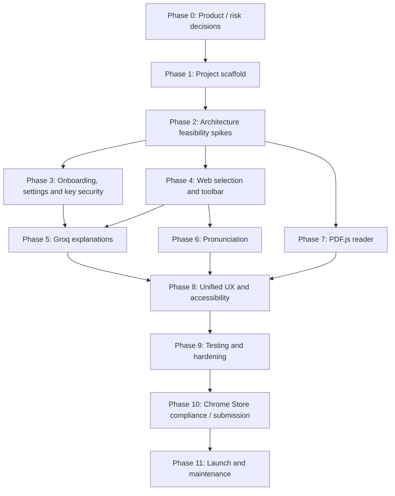

# Execution phases — Clavis

**Document status:** v1 end-to-end implementation playbook (rev. 1.1 — decisions D-01 … D-16)  
**Baseline:** 2026-10-22 · **Goal:** deliver a privacy-conscious, production-ready Chrome MV3 extension with Groq BYOK, word/sentence pronunciation, contextual explanations, and a custom PDF reader.

> Use this as the project's **build checklist and milestone tracker**. Feature IDs correspond to [requirements.md](requirements.md); implementation boundaries are in [architecture.md](architecture.md); approved tools are in [tech-stack.md](tech-stack.md). Product decisions D-01 … D-16 are in [requirements.md §11](requirements.md#11-product-decisions).

## 0. Delivery philosophy and estimates

**Don't start with a polished landing page.** Prove the three high-risk behaviors first: (1) Groq BYOK from MV3 service worker, (2) anchored selection tooltip on real webpages, and (3) selectable PDF.js text layer. If any spike fails, resolve the architecture before building surrounding UI.

**Indicative effort (one experienced TypeScript/React developer, focused effort):** approximately **4–7 weeks** from first commit to a review-ready v1, plus Chrome Web Store review (typically days, sometimes weeks). A smaller internal demo may take 1–2 weeks. These are planning ranges, not delivery promises. The D-03/D-04/D-05/D-06 scope decisions removed most of the previous upper range; Linux voice coverage, first-selection latency and store review are the main remaining schedule variables.

### Workstream dependencies

### Estimated sequence and gate summary

| Phase | Approx. effort | Exit gate |
| --- | --- | --- |
| 0 — Specification & risks | Done 2026-10-22 | Scope frozen, decisions D-01 … D-16 logged |
| 1 — Scaffold & CI | Done 2026-10-22 | Unpacked extension loads; lint/test/build pipeline works |
| 2 — Feasibility spikes | 2–4 days | Groq call + model comparison, permission flow + toolbar latency, PDF viewer text layer and TTS capability proven |
| 3 — Onboarding & BYOK | 2–4 days | Site access, valid/invalid keys, trusted storage and settings covered |
| 4 — Web highlight toolbar | 3–5 days | Reliable selection/position/dismiss/keyboard behavior on both injection paths |
| 5 — AI explanation | 3–4 days | Core request + Must tabs function with typed responses |
| 6 — Listen/TTS | 1–3 days | Word + sentence playback with usable no-voice fallback |
| 7 — Custom PDF reader | 3–5 days | Local PDF in viewer components + text selection + reader controls |
| 8 — Unified UX | 2–4 days | Web/PDF consistent; side panel, copy, Should tabs if on schedule |
| 9 — Hardening and QA | 3–6 days | Acceptance matrix, privacy and performance gates pass |
| 10 — Store package / submit | 1–3 days preparation | Complete listing, privacy policy, ZIP and review submission |
| 11 — After submission | Ongoing | Review feedback resolved; published; versioned maintenance |

Effort counts are overlapping planning estimates, not additive deadlines; use them as a backlog and adjust based on actual results. The store review period is not under developer control.

## Phase 0 — Project definition and foundational decisions

**Goal:** convert the feature idea into a release commitment and eliminate scope confusion.

**Tasks**

- [x] Product name: **Clavis** (D-01).
- [x] Read all five docs and ratify requirement priorities (Must/Should/Could/Later/Won't).
- [x] Agree that **Groq only** ships initially; all other provider UI is hidden.
- [x] Agree that **custom PDF reader** is the supported PDF experience, local files only in v1 (D-03); native Chrome PDF viewer overlay is not a launch promise.
- [x] Agree that **Listen works independently of Groq**, for both words and sentences.
- [x] Permission decision: optional all-sites access requested at onboarding + `activeTab` fallback (D-02, ADR A-011).
- [x] Explanation scope: core request + lazy tabs; grammar/translate are Should (D-05).
- [x] Establish supported content boundaries (≤2,000 selected characters; ≤1,000 context characters initially) and the over-limit behavior.
- [x] Define the exact disclosure text a user sees before the first selected text/context is sent to Groq — [approved copy](requirements.md#approved-disclosure-copy-fr-002-fr-009-fr-071) (D-16).
- [x] Select the target Chrome versions/OS testing matrix — Linux by hand, Windows/macOS automated, minimum Chrome tentatively 116 ([platform matrix](requirements.md#platform-matrix-d-14), D-14).
- [x] Record legal/privacy decisions and remaining open items — MIT license (D-13, `LICENSE` added), privacy policy on GitHub Pages with a [draft](privacy-policy.md) (D-15); publisher, support email and logo deferred to Phase 10 ([still open](requirements.md#still-open)).

**Deliverables (done 2026-10-22):** approved scope and decisions D-01 … D-16 ([requirements.md §11](requirements.md#11-product-decisions)); ADRs A-001 … A-013 ([architecture.md §1](architecture.md#1-architectural-decisions-adrs)); requirement checklist, prioritized backlog and risk register ([backlog.md](backlog.md)); privacy policy draft ([privacy-policy.md](privacy-policy.md)).  
**Gate:** No launch-time features are ambiguous or promised beyond demonstrated browser capabilities. **Passed** — remaining unknowns are either Phase 2 spike outputs with defined decision criteria or Phase 10 publishing details.

## Phase 1 — Repository, WXT scaffold and developer tooling

**Goal:** reproducible engineering foundation.

**Tasks**

- [x] Scaffold WXT 0.21.4 (React, TypeScript, npm) in the existing `Clavis/` repository, keeping `docs/` in place.
- [x] Commit lockfile, `.gitignore`, `LICENSE` (MIT, D-13) and the `docs/` folder. Agent tooling folders (`.claude/`, `.codex/`, `.agents/`) are committed.
- [x] Add CI jobs on Linux, Windows and macOS runners for the automated E2E coverage in the [platform matrix](requirements.md#platform-matrix-d-14) (D-14) — `.github/workflows/ci.yml`. Not yet run: no GitHub remote exists.
- [x] Configure TypeScript strict mode, linting, formatting, Vitest and the Playwright harness. Node-side TypeScript is checked by `tsconfig.node.json`; ESLint blocks Node globals, `eval` and HTML-string rendering in extension code.
- [x] Create `entrypoints/background.ts`, `content.ts` (runtime-registered observer), `popup`, `onboarding`, `options`, `reader`. The side panel is deferred to Phase 8 (FR-042).
- [x] Set up `public/_locales/en/messages.json` and use `chrome.i18n` for every user-visible string (D-11); a unit test checks every key used exists.
- [x] Add a bundle-size check and fail on content-script budget overruns (`npm run size`, [tech-stack.md §6](tech-stack.md#content-script-budget-d-08)).
- [x] Create `lib/contracts`, `lib/config`, `lib/security`, `lib/i18n` and `components`. `lib/ai`, `lib/pdf`, `lib/speech` and `lib/storage` are created with their first code in Phase 2+.
- [x] Add a single source of truth for routes, provider endpoints, limits and model candidates (`lib/config/constants.ts`).
- [x] Introduce Zod schemas for versioned messages, selection data and validated AI responses (`lib/contracts`, 107 unit tests).
- [x] Configure safe build artifact handling: `.env` exclusion, release-ZIP audit (`npm run audit:zip`) and gitleaks secret scanning.
- [x] Add CI for typecheck, lint, format, unit tests, build, size, ZIP and audit; `npm run ci` runs the same locally.
- [x] Verify the extension loads from built output — Playwright loads `.output/chrome-mv3` in Chromium and checks the service worker, manifest, popup and onboarding pages (`npm run test:e2e`).

**Phase 1 follow-ups (scheduled later):**

- Phase 3: register the content script at runtime with the real `OPTIONAL_SITE_ORIGINS` patterns (the entrypoint uses `matches: []`, because WXT copies runtime-script matches into `host_permissions`); storage-reading message routes must await the background's `setAccessLevel` promise; check message senders in the router; define the `GET_AI_STATUS` reply contract.
- Phase 5: adjust optional fields in mode output schemas for Groq strict JSON-schema mode (or use JSON mode); retune output length bounds after Spike A.
- Phase 9: add the minimum-Chrome smoke test against a pinned Chrome for Testing 116 build (D-14).
- Before Phase 10: first real CI run once a GitHub remote exists; confirm the Groq privacy-policy URL used in onboarding.

**Deliverables (done 2026-10-22):** loading MV3 extension with popup, onboarding, options and reader pages; generated manifest matching [architecture.md §3](architecture.md#3-extension-entry-points-and-message-routes); CI pipeline.  
**Gate:** Fresh clone installs, runs, builds and packages without secrets or missing imports. **Passed locally on Linux 2026-10-22** (`npm run ci`, `npm run test:e2e`).

## Phase 2 — Feasibility spikes (complete before UI polish)

**Goal:** prove technical assumptions that could cause rework.

### Spike A: Groq BYOK from trusted extension context

- [ ] Get a test key from <https://console.groq.com/keys> (never commit it).
- [ ] Add minimal `https://api.groq.com/*` host permission for extension background fetch (this also exempts the fetch from CORS).
- [ ] Verify authenticated model-list/connection and `chat/completions` requests from background service worker **in a packaged extension**.
- [ ] Confirm which models accept `response_format` JSON schema / JSON mode and `reasoning_effort`; record capability differences.
- [ ] **Model comparison (D-09):** run the `core` prompt on the semantic regression fixtures against `openai/gpt-oss-20b`, `openai/gpt-oss-120b` and at least one fast non-reasoning model available to the account. Record p50/p95 latency, completion tokens (including reasoning), JSON validity rate and answer quality. Choose the quick/deep defaults and per-mode `max_completion_tokens`.
- [ ] Confirm model IDs and free limits against live provider data.
- [ ] Test 401/403/404/429 paths (use mocks for rate-limit scenarios if needed).

### Spike B: Site access, selection + tooltip

- [ ] Declare `optional_host_permissions` for http/https; request them from a button on an extension page; on grant, `registerContentScripts`; on revoke, unregister. Confirm the install prompt shows no all-sites warning.
- [ ] Verify the declined path: context menu **Explain with Clavis** and toolbar-icon click inject into the current tab via `activeTab`.
- [ ] Capture selected text on at least 5 webpage fixtures with different layouts, including an iframe.
- [ ] Check placement at viewport corners, nested inline text, scroll containers and zoom.
- [ ] Render a Shadow DOM toolbar and retain selection snapshot after button click.
- [ ] **UI loading (D-08):** implement the toolbar with the candidate loading options in [architecture.md §5](architecture.md#5-end-to-end-selection-flow); measure observer size, UI chunk size and first-selection p95 latency on a mid-range machine; pick one and record the numbers.
- [ ] Test Chrome restricted pages and don't attempt injection where unsupported.

### Spike C: PDF.js viewer components

- [ ] Open a local text-based PDF in the extension reader using `PDFViewer` + `EventBus` + `PDFLinkService` + `PDFFindController` and the bundled worker (D-06).
- [ ] Confirm aligned selectable text layer at 100%, 125% and 175%, and fit-width.
- [ ] Capture selected sentence, with page metadata and exact selected string.
- [ ] Open a 100-page PDF and confirm only nearby pages hold canvases while scrolling.
- [ ] Confirm find-in-document works through `PDFFindController`.
- [ ] Attempt a scan-only PDF and show that OCR is not available in v1.
- [ ] Test offline operation, a corrupt PDF and a password-protected PDF.

### Spike D: Voices

- [ ] Query `chrome.tts.getVoices()` and speak word and full sentence on each available OS.
- [ ] Exercise Stop/Replay and both rate presets.
- [ ] On Linux (the dev machine), record whether `chrome.tts` has any voice.
- [ ] **Fallback (D-07):** create an offscreen document (`AUDIO_PLAYBACK`), speak via `speechSynthesis`, relay start/end/error events; also test `speechSynthesis` directly in the reader page. Record per OS whether audio is actually produced.
- [ ] Decide per OS whether the fallback is adopted; add the `offscreen` permission only if it is.

**Deliverables:** Minimal spike pages, findings recorded in `docs/decisions/` (model comparison table, UI loading measurements, voice matrix), corrected acceptance scope.  
**Gate:** All four spikes have a demonstrable working or consciously downgraded implementation path. **Do not proceed with risky promises unresolved.**

## Phase 3 — Onboarding, preferences and Groq key lifecycle

**Goal:** a nontechnical user can get running securely.

**Tasks**

- [ ] Build welcome/onboarding wizard: purpose -> privacy disclosure -> **Enable Clavis on websites** (optional permission) -> Get Groq Key -> Connect -> Preferences -> guided demo on a bundled practice page.
- [ ] Settings: show site-access status with Grant / Revoke, and a per-site disable list (FR-009).
- [ ] Build key input with masked characters and deliberate submit.
- [ ] Implement key storage and sender checks exactly as specified in the [secret boundary](architecture.md#secret-boundary-normative) (persistent and session-only options).
- [ ] Implement model-list/test-connection path; distinguish authentication error from network error.
- [ ] Display model selector from compatible available models, noting any account quota limitations.
- [ ] Add Settings to change key, test again, remove key and choose speech locale/rate/reading level.
- [ ] Add privacy and help links plus explicit disclosure that Groq receives selected text/context after Explain.
- [ ] Add simple 'not connected' mode: PDF reader + detected TTS remain available; AI actions ask for setup.
- [ ] Unit/integration tests for settings persistence, key inaccessibility from content script and clear-data behavior.

**Deliverables:** Usable first-run setup, working provider status, no secret leakage in test traces.  
**Gate:** A fresh user can grant or decline site access and set up, validate, change and remove a Groq key without developer assistance (FR-001–009, FR-070–073).

## Phase 4 — Production webpage selection and toolbar

**Goal:** reliable, unintrusive reading workflow.

**Tasks**

- [ ] Build the framework-free DOM selection observer using `selectionchange` + mouseup/keyup with minimal debounce; keep it within the size budget.
- [ ] Implement the UI loading option chosen in Spike B; load UI only on the first qualifying selection.
- [ ] Skip collapsed selection, hidden/unsafe editable input, unsupported protocol, excluded host and disallowed page contexts. For over-limit selections, show **Use the first 2,000 characters**.
- [ ] Classify selection (word/phrase/sentence/passage) and normalize whitespace without changing meaning.
- [ ] Extract limited local semantic context from adjacent text only; never entire document.
- [ ] Create `SelectionSnapshot` with selectionId and optional PDF metadata.
- [ ] Position toolbar near selected Range rect while avoiding clipping/covered text.
- [ ] Use Shadow DOM CSS isolation; test website CSS conflicts and z-index collisions.
- [ ] Preserve snapshot through toolbar button interaction (avoid browser selection collapse bug).
- [ ] Add close/Escape/outside click, keyboard focus, reduced-motion and proper aria labels.
- [ ] Implement runtime registration on permission grant, unregistration on revoke, and the per-site disable setting (D-02).
- [ ] Implement the **Explain with Clavis** context menu and toolbar-icon injection for tabs without site access (FR-018).
- [ ] Check **network: no AI call when selecting text alone**.
- [ ] Browser E2E against complex long-form sites, multi-column, nested HTML and narrow viewports, with site access granted and declined.

**Deliverables:** Stable tooltip with Listen and Explain actions on both injection paths, local states only.  
**Gate:** FR-010–018 acceptance tests pass on supported website fixtures; first-selection latency within budget.

## Phase 5 — Groq-powered language intelligence

**Goal:** safe, structured, useful explanations.

**Tasks**

- [ ] Implement `AIProvider` abstraction with single Groq adapter (only provider shipped).
- [ ] Add background `AI_EXPLAIN` message handler with request/schema validation, user-key retrieval and model setting.
- [ ] Design system prompts treating source text as **untrusted data**, not AI instructions.
- [ ] Implement the `core` prompt (contextual meaning + definition + 2 examples) and the Must lazy-tab prompts: roots/etymology, related words, simplification (D-05). Grammar and translation prompts are Should, behind a feature flag.
- [ ] Implement bounded per-mode JSON schemas; adapt to selected model's supported response format and the token budgets from Spike A.
- [ ] Validate model response via Zod; map it to shared `ExplainResult`; render all fields as plain text (D-10).
- [ ] Build explanation card: header, core answer, lazy tabs that request on first open and reuse the per-selection cache afterwards, close/copy, uncertainty notes.
- [ ] Verify with network inspection: one request per Explain click, at most one more per newly opened tab, none when reopening a loaded tab.
- [ ] Handle long response in side panel if that feature is enabled; never block the main page.
- [ ] Implement requestId + selectionId checks, timeouts, cancellation and stale-response discard.
- [ ] Add rate-limit handling with `Retry-After`, network errors, missing key, unavailable model, malformed output and clear Retry/Settings actions.
- [ ] Prompt regression fixtures: `bank` senses, idioms, phrase vs sentence, factual ambiguity, invented etymology, unfamiliar languages, injection attempts.
- [ ] Verify no raw selected text, key or auth headers appear in application logs or browser-visible page DOM.

**Deliverables:** Core explanation and every Must tab accessible and validated; no malformed JSON crashes.  
**Gate:** FR-030–035 and FR-038–041 and security checks pass; Groq call only on explicit action.

## Phase 6 — Pronunciation for words and sentences

**Goal:** independent no-token voice playback.

**Tasks**

- [ ] Implement `SpeechService` API: `getVoices`, `speak`, `stop`, `replay`, rate and locale.
- [ ] Wire **Listen** from webpage tooltip to background TTS handler without an AI request.
- [ ] Wire **Listen** from reader text selection to the same handler.
- [ ] Verify single-word, phrase and full-sentence playback including punctuation.
- [ ] Offer Normal and Slow speeds, Stop/Replay; update playing state from actual events.
- [ ] Support best-effort American/British voices when installed; never fake unavailable accent availability.
- [ ] Detect empty voice list and playback errors on Linux/other platforms; show helpful fallbacks.
- [ ] If Spike D adopted it, implement the offscreen-document `speechSynthesis` fallback for webpage selections and direct `speechSynthesis` in the reader, behind `SpeechService` (D-07).
- [ ] Test rapid selection and repeated clicks, cancellation and extension navigation.
- [ ] Confirm audio playback is usable without a Groq key on supported voice engines.

**Deliverables:** Shared pronunciation control; accurate voice capability states.  
**Gate:** FR-020–024 pass for all tested supported systems; no-voice scenario is graceful.

## Phase 7 — Build the custom PDF reader

**Goal:** text-selection experience in PDFs is as capable as on webpages.

### Minimum working local PDF reader

- [ ] Add `reader` extension page with Open PDF, file picker and drag/drop.
- [ ] Bundle PDF.js core, viewer components, `pdf_viewer.css` and the matching worker (same version); configure assets for built extension.
- [ ] Load local file via `File`/`ArrayBuffer`; enforce reasonable per-file limit and show progress.
- [ ] Mount `PDFViewer` with `EventBus`, `PDFLinkService` and `PDFFindController` in the React shell (D-06); `isEvalSupported: false`; confirm before external links.
- [ ] Add page number, navigation, zoom +/−, fit width, loading and error components driven by viewer events.
- [ ] Use shared `SelectionSnapshot` + tooltip, selection anchor logic, Explain and Listen.
- [ ] Capture page metadata for selections across words/sentences.
- [ ] Clean up on close: `setDocument(null)`, `doc.destroy()`, object URLs.
- [ ] Test PDF at different zoom/rotation, page count, 100-page documents (virtualization) and keyboard focus.

### Hardening and reader enhancements

- [ ] Wire find-in-document UI to `PDFFindController` (Should).
- [ ] Add password prompt handling for encrypted PDF via `onPassword`.
- [ ] Clearly distinguish corrupt file vs scan-only text vs missing font/worker.
- [ ] Verify no PDF bytes are posted to Groq; only user-selected text and bounded context on Explain.

Remote PDF URLs and thumbnails are not part of v1 (D-03; thumbnails are a Could).

**Deliverables:** Stable local PDF reader, common explanations/TTS, graceful limitations.  
**Gate:** FR-050–056 and FR-059 pass; FR-057 if implemented; scanned-only file not misrepresented as selectable.

## Phase 8 — Integrated UX and accessibility

**Goal:** coherent user experience, not disjoint technical demos.

**Tasks**

- [ ] Make Explain/Listen actions look and behave the same in webpage and PDF reader.
- [ ] Refine word/phrase/sentence-aware action sets; hide irrelevant modes.
- [ ] Make long explanations navigable in side panel when selected scope supports it.
- [ ] Add Copy answer, dismiss, retry, provider status, and clear no-key prompts.
- [ ] Optimize spacing/position, scroll behavior, dark mode and small windows.
- [ ] Test language direction, Unicode, accessible text labels and keyboard navigation.
- [ ] If on schedule, enable the Grammar and Translate tabs (Should, FR-036/037) after their prompt regression fixtures pass; otherwise leave them flagged off.
- [ ] Add help screen explaining why native Chrome PDF viewer can't host overlay, and how to open custom reader.
- [ ] Add help text for users who declined site access, explaining the context-menu path and how to enable automatic mode.
- [ ] Remove all placeholder controls that do nothing in final ZIP.

**Deliverables:** Cohesive, accessible product UI and truthful limitation copy.  
**Gate:** End-to-end tasks completed without developer-only instructions; optional features are finished or removed.

## Phase 9 — QA, performance, reliability, privacy and security

**Goal:** release candidate that passes requirements and extension policy.

### Automated verification

- [ ] Typecheck, lint and unit suite all pass in CI.
- [ ] Add `chrome.runtime`/storage message integration tests and secret-boundary checks.
- [ ] E2E tests for full setup -> grant site access -> highlight -> Listen -> Explain -> open tab -> dismiss.
- [ ] E2E tests for the declined-access path: context menu -> Explain -> card.
- [ ] E2E tests for local PDF open -> page navigation -> select -> Listen -> Explain.
- [ ] Mock Groq 401/403/404/429/5xx, invalid JSON, huge answers, missing key, offline and worker cancellation.
- [ ] Regression test navigation/reselection stale answers and toolbar persistence.
- [ ] PDF large-file/malformed/encrypted/scan-only and voice absent fixtures.
- [ ] Run automated accessibility audits; manual keyboard and screen-reader spot checks.

### Security, privacy and performance

- [ ] Capture Chrome network traffic: zero selection-only AI requests.
- [ ] Inspect content-script messages/DOM/storage to confirm key never leaves trusted extension contexts.
- [ ] Fuzz selected text with HTML, model jailbreak text, URLs and Unicode; no code execution.
- [ ] Check that PDF worker and scripts are bundled and no remote executable code loads.
- [ ] Audit minimum necessary manifest permissions and their developer-dashboard justifications.
- [ ] Validate per-site disable, granting site access later, and revoking it (registration removed).
- [ ] Verify `web_accessible_resources` exposes nothing beyond the chosen lazy UI chunk, with `use_dynamic_url`.
- [ ] Set memory budget for reader and verify that long PDF doesn't create unbounded canvases.
- [ ] Measure first and repeat toolbar p95 against the budget; track AI latency without promising backend SLA.
- [ ] Count Groq requests per session in E2E: one per Explain, one per newly opened tab, zero on reopen.
- [ ] Inspect ZIP for secrets, debug keys, `.env`, localhost URLs, unsupported features and source map leakage.
- [ ] Recheck Chrome/Groq/PDF.js dependency and security advisories before release.

**Deliverables:** Test report tied to requirement IDs, triaged defect list, candidate version.  
**Gate:** No blocking bugs, security leaks, policy conflicts or broken core flows.

## Phase 10 — Chrome Web Store submission

**Goal:** accepted listing and production package.

### Publisher prep

- [ ] Register developer in official Chrome Web Store dashboard (<https://chrome.google.com/webstore/devconsole>); pay applicable one-time fee and complete verification.
- [ ] Enable 2-Step Verification on the publisher account; confirm account/contact details.
- [ ] Confirm publisher display name, icon and extension description for **Clavis**.
- [ ] Fill the placeholders in [privacy-policy.md](privacy-policy.md), re-check it against the shipped code, and publish it on GitHub Pages (D-15).
- [ ] Complete one manual release smoke-test pass on Windows or macOS before switching the listing to public (D-14).
- [ ] Decide/publicize support email, basic FAQ, bug reporting process.

### Listing content

- [ ] Create icons at 16×16, 32×32, 48×48 and 128×128 PNG where applicable; include a 128×128 extension/store icon.
- [ ] Create actual-product screenshots (typically 1280×800 or 640×400) and any required promotional tile; verify live dashboard requirements before submission.
- [ ] Write simple store description: highlight -> listen -> understand -> PDF reader; no misleading native-PDF or unlimited-free claims.
- [ ] Document user API-key setup in listing/help page; reviewers must understand BYOK requirement.
- [ ] Fill Privacy Practices/data collection forms accurately; identify Groq as third-party processor recipient for explicit AI action.
- [ ] Justify every permission in [architecture.md §3](architecture.md#3-extension-entry-points-and-message-routes), including the optional http/https access, based on implemented functionality.
- [ ] Verify third-party open-source license attributions and any required notices.

### Packaging and review

- [ ] Increment semantic version and update changelog.
- [ ] Run `npm run build` and `npm run zip`; verify generated WXT output/ZIP.
- [ ] Load **exact ZIP artifact** (unpack to clean profile) and execute release smoke checklist.
- [ ] Upload ZIP through Chrome Web Store developer dashboard.
- [ ] Select distribution visibility (trusted testers first if useful, then public).
- [ ] Submit for review; save submission timestamp and revision ID.
- [ ] Respond to review questions with accurate feature steps and privacy explanations.
- [ ] If rejected, map feedback to requirements and fix before resubmitting.

**Review timing:** Chrome says **most reviews finish within a few days**, but they can take **weeks**; new extensions or broad permissions may take longer. Contact developer support after >3 weeks of pending review as documented. Do not tie a public campaign to an unapproved launch date.

**Deliverables:** Published privacy-policy URL, store listing assets, signed-off ZIP and submitted item.  
**Gate:** Review submitted successfully with all disclosures and true claims.

## Phase 11 — Release, support and iteration

**Goal:** maintain trust, stability and user value after approval.

- [ ] Once approved, publish according to selected distribution settings.
- [ ] Verify first-run experience on clean install from public listing, not only unpacked dev build.
- [ ] Monitor store reviews/support inbox for failed Groq onboarding, voice availability and PDF issues (do not ask users to send secrets).
- [ ] Publish release notes with known platform limitations.
- [ ] Track provider model deprecations/free-tier changes and surface compatibility alerts through UI on connection test.
- [ ] Patch PDF.js/extension dependencies routinely; release updates through same store review process.
- [ ] Keep privacy policy, listing and permissions in sync with any functionality changes.
- [ ] Prioritize next release with evidence. Planned "Later" items: remote PDF URLs and "Open in Clavis" on PDF links (D-03), saved vocabulary with export (D-04), grammar/translate if not shipped, more UI languages; then IPA recordings, OCR and eventually additional model providers.
- [ ] Never silently add telemetry, an external provider, background browsing collection, or new permissions without corresponding disclosure and policy review.

## Release-day smoke test (minimum)

Run this against the actual distribution build:

1. [ ] Install in a clean Chrome profile; no all-sites warning at install; welcome page appears once.
2. [ ] Decline site access: context menu **Explain with Clavis** works on an article. Then grant access from Settings: toolbar appears automatically on the next page load.
3. [ ] Key missing: reading and TTS work; Explain opens setup prompt.
4. [ ] Enter valid Groq key, choose supported model, Test Connection passes.
5. [ ] Invalid key clearly rejected without leaking credential.
6. [ ] Select ordinary word on public article; toolbar appears, listens, and contextual AI interpretation is accurate; opening Roots makes exactly one more request.
7. [ ] Select full sentence; Listen speaks entire sentence with Stop and Slow controls (or shows the no-voice message).
8. [ ] Dismiss with Escape; keyboard re-open/focus logical.
9. [ ] Open local multi-page PDF via reader; zoom, select text, Listen, Explain.
10. [ ] Open scan-only PDF; clear text-selection limitation displayed.
11. [ ] Simulate Groq rate limit; provider error and retry guidance appear.
12. [ ] Turn off network; reader and suitable local TTS remain available while Explain shows offline state.
13. [ ] Remove key and clear saved data; background AI requests stop.
14. [ ] Production bundle has no remote code/secrets; privacy policy/store permission description corresponds to actual code.

## Backlog mapping by requirement

| Requirements | Primary delivery phase | Verification phase |
| --- | --- | --- |
| FR-001–009 (onboarding/site access/key/preferences) | 3 | 9 / 10 |
| FR-010–019 (selection, toolbar, declined-access path) | 4 / 8 | 9 |
| FR-020–026 (pronunciation) | 6 | 9 |
| FR-030–035, 038–041 (core + Must tabs) | 5 | 9 |
| FR-036–037, 042–043 (Should tabs, side panel, cache) | 8 | 9 |
| FR-050–057, 059–060 (PDF reader) | 7 | 9 |
| FR-070–078 (privacy/reliability/store) | 1–10 | 9 / 10 |
| FR-058, FR-079 (Later) | Post-v1 | — |

## Definition of ready for a task

- Requirement ID and observable acceptance test identified.
- UI screenshot/sketch or exact interaction behavior agreed.
- Data and permission implications reviewed.
- Dependency/version/API known and cited.
- Clear fallback for Chrome/Groq/PDF.js failures.
- Can test in a real MV3 browser context.

## Definition of done for a pull request

- Implementation satisfies requirement ID and matches architecture boundary.
- Types + Zod schema added/updated where data crosses context.
- Unit/integration/browser tests updated for critical behavior.
- No API key or selected page/PDF content in logs.
- Keyboard, error and loading states tested; no dead controls.
- Packaging build succeeds; changes do not add unapproved permissions or remote executable code.
- All affected documentation updated, including ADR/permissions/privacy if relevant.

## Definition of done for public v1

**All** Must functional requirements pass documented tests, plus a reviewer-ready Chrome Web Store listing and accessible privacy policy; direct user-key Groq calling works and is limited to user-triggered explanations; ordinary webpage and custom PDF highlighting work as claimed; word and sentence TTS works when compatible voices exist with honest fallback otherwise; there is no unauthorized collection, key exposure or hidden first-party backend.

## Contingency priorities if schedule slips

**Never cut:** credential boundaries; explicit AI send; clear data disclosures; no-voice/error states; local PDF reader if PDF is advertised; accessibility of core action controls; secure ZIP and test coverage of security boundaries.

**Cut first:** Grammar and Translate tabs, PDF find, complex side panel interactions, decorative motion, advanced IPA and recorded audio. (Remote PDF URLs, thumbnails and vocabulary saving are already out of v1.) Put cut items behind explicit post-launch milestones instead of shipping unfinished controls.

## Official submission and engineering references

- WXT installation / packaging: <https://wxt.dev/guide/installation>
- Chrome developer account: <https://developer.chrome.com/docs/webstore/register>
- Chrome Web Store publishing: <https://developer.chrome.com/docs/webstore/publish>
- Review timings: <https://developer.chrome.com/docs/webstore/review-process>
- Web Store privacy rules: <https://developer.chrome.com/docs/webstore/program-policies/policies>
- Groq API reference and quota: <https://console.groq.com/docs/api-reference> · <https://console.groq.com/docs/rate-limits>
- PDF.js project: <https://github.com/mozilla/pdf.js>
