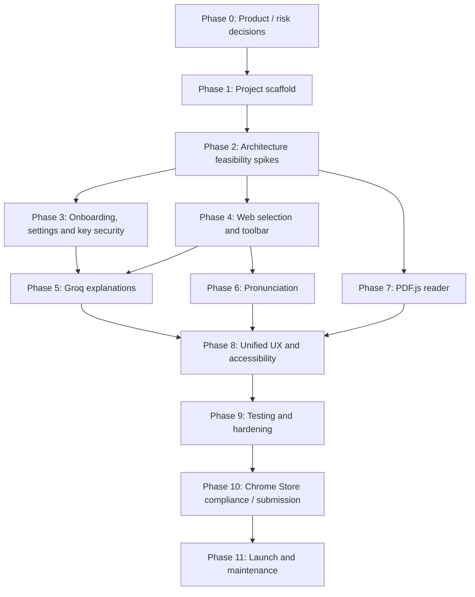

# Execution phases — Clavis

**Document status:** v1 end-to-end implementation playbook (rev. 1.1 — decisions D-01 … D-25)  
**Baseline:** 2026-10-22 · **Goal:** deliver a privacy-conscious, production-ready Chrome MV3 extension with Groq BYOK, word/sentence pronunciation, contextual explanations, and a custom PDF reader.

> Use this as the project's **build checklist and milestone tracker**. Feature IDs correspond to [requirements.md](requirements.md); implementation boundaries are in [architecture.md](architecture.md); approved tools are in [tech-stack.md](tech-stack.md). Product decisions D-01 … D-25 are in [requirements.md §11](requirements.md#11-product-decisions).

## 0. Delivery philosophy and estimates

**Don't start with a polished landing page.** Prove the three high-risk behaviors first: (1) Groq BYOK from MV3 service worker, (2) anchored selection tooltip on real webpages, and (3) selectable PDF.js text layer. If any spike fails, resolve the architecture before building surrounding UI.

**Indicative effort (one experienced TypeScript/React developer, focused effort):** approximately **4–7 weeks** from first commit to a review-ready v1, plus Chrome Web Store review (typically days, sometimes weeks). A smaller internal demo may take 1–2 weeks. These are planning ranges, not delivery promises. The D-03/D-04/D-05/D-06 scope decisions removed most of the previous upper range; Linux voice coverage, first-selection latency and store review are the main remaining schedule variables.

### Workstream dependencies

### Estimated sequence and gate summary

| Phase | Approx. effort | Exit gate |
| --- | --- | --- |
| 0 — Specification & risks | Done 2026-10-22 | Scope frozen, decisions D-01 … D-25 logged |
| 1 — Scaffold & CI | Done 2026-10-22 | Unpacked extension loads; lint/test/build pipeline works |
| 2 — Feasibility spikes | Engineering done 2026-10-22; awaiting user runs | Groq call + model comparison, permission flow + toolbar latency, PDF viewer text layer and TTS capability proven |
| 3 — Onboarding & BYOK | Done 2026-10-22 | Site access, valid/invalid keys, trusted storage and settings covered |
| 4 — Web highlight toolbar | Done 2026-10-22 | Reliable selection/position/dismiss/keyboard behavior on both injection paths |
| 5 — AI explanation | Done 2026-10-23 | Core request + Must tabs function with typed responses |
| 6 — Listen/TTS | Done 2026-10-23 | Word + sentence playback with usable no-voice fallback |
| 7 — Custom PDF reader | 3–5 days | Local PDF in viewer components + text selection + reader controls |
| 8 — Unified UX | 2–4 days | Web/PDF consistent; side panel, copy, Should tabs if on schedule |
| 9 — Hardening and QA | 3–6 days | Acceptance matrix, privacy and performance gates pass |
| 10 — Store package / submit | 1–3 days preparation | Complete listing, privacy policy, ZIP and review submission |
| 11 — After submission | Ongoing | Review feedback resolved; published; versioned maintenance |

Effort counts are overlapping planning estimates, not additive deadlines; use them as a backlog and adjust based on actual results. The store review period is not under developer control.

## Phase 0 — Project definition and foundational decisions

**Goal:** convert the feature idea into a release commitment and eliminate scope confusion.

**Tasks**

- [x] Product name: **Clavis** (D-01).
- [x] Read all five docs and ratify requirement priorities (Must/Should/Could/Later/Won't).
- [x] Agree that **Groq only** ships initially; all other provider UI is hidden.
- [x] Agree that **custom PDF reader** is the supported PDF experience, local files only in v1 (D-03); native Chrome PDF viewer overlay is not a launch promise.
- [x] Agree that **Listen works independently of Groq**, for both words and sentences.
- [x] Permission decision: optional all-sites access requested at onboarding + `activeTab` fallback (D-02, ADR A-011).
- [x] Explanation scope: core request + lazy tabs; grammar/translate are Should (D-05).
- [x] Establish supported content boundaries (≤2,000 selected characters; ≤1,000 context characters initially) and the over-limit behavior.
- [x] Define the exact disclosure text a user sees before the first selected text/context is sent to Groq — [approved copy](requirements.md#approved-disclosure-copy-fr-002-fr-009-fr-071) (D-16).
- [x] Select the target Chrome versions/OS testing matrix — Linux by hand, Windows/macOS automated, minimum Chrome tentatively 116, later set to 147 by D-18 ([platform matrix](requirements.md#platform-matrix-d-14), D-14).
- [x] Record legal/privacy decisions and remaining open items — MIT license (D-13, `LICENSE` added), privacy policy on GitHub Pages with a [draft](privacy-policy.md) (D-15); publisher, support email and logo deferred to Phase 10 ([still open](requirements.md#still-open)).

**Deliverables (done 2026-10-22):** approved scope and decisions D-01 … D-25 ([requirements.md §11](requirements.md#11-product-decisions)); ADRs A-001 … A-013 ([architecture.md §1](architecture.md#1-architectural-decisions-adrs)); requirement checklist, prioritized backlog and risk register ([backlog.md](backlog.md)); privacy policy draft ([privacy-policy.md](privacy-policy.md)).  
**Gate:** No launch-time features are ambiguous or promised beyond demonstrated browser capabilities. **Passed** — remaining unknowns are either Phase 2 spike outputs with defined decision criteria or Phase 10 publishing details.

## Phase 1 — Repository, WXT scaffold and developer tooling

**Goal:** reproducible engineering foundation.

**Tasks**

- [x] Scaffold WXT 0.21.4 (React, TypeScript, npm) in the existing `Clavis/` repository, keeping `docs/` in place.
- [x] Commit lockfile, `.gitignore`, `LICENSE` (MIT, D-13) and the `docs/` folder. Agent tooling folders (`.claude/`, `.codex/`, `.agents/`) are committed.
- [x] Add CI jobs on Linux, Windows and macOS runners for the automated E2E coverage in the [platform matrix](requirements.md#platform-matrix-d-14) (D-14) — `.github/workflows/ci.yml`. Not yet run: no GitHub remote exists.
- [x] Configure TypeScript strict mode, linting, formatting, Vitest and the Playwright harness. Node-side TypeScript is checked by `tsconfig.node.json`; ESLint blocks Node globals, `eval` and HTML-string rendering in extension code.
- [x] Create `entrypoints/background.ts`, `content.ts` (runtime-registered observer), `popup`, `onboarding`, `options`, `reader`. The side panel is deferred to Phase 8 (FR-042).
- [x] Set up `public/_locales/en/messages.json` and use `chrome.i18n` for every user-visible string (D-11); a unit test checks every key used exists.
- [x] Add a bundle-size check and fail on content-script budget overruns (`npm run size`, [tech-stack.md §6](tech-stack.md#content-script-budget-d-08)).
- [x] Create `lib/contracts`, `lib/config`, `lib/security`, `lib/i18n` and `components`. `lib/ai`, `lib/pdf`, `lib/speech` and `lib/storage` are created with their first code in Phase 2+.
- [x] Add a single source of truth for routes, provider endpoints, limits and model candidates (`lib/config/constants.ts`).
- [x] Introduce Zod schemas for versioned messages, selection data and validated AI responses (`lib/contracts`, 107 unit tests).
- [x] Configure safe build artifact handling: `.env` exclusion, release-ZIP audit (`npm run audit:zip`) and gitleaks secret scanning.
- [x] Add CI for typecheck, lint, format, unit tests, build, size, ZIP and audit; `npm run ci` runs the same locally.
- [x] Verify the extension loads from built output — Playwright loads `.output/chrome-mv3` in Chromium and checks the service worker, manifest, popup and onboarding pages (`npm run test:e2e`).

**Phase 1 follow-ups (scheduled later):**

- Phase 3: register the content script at runtime with the real `OPTIONAL_SITE_ORIGINS` patterns (the entrypoint uses `matches: []`, because WXT copies runtime-script matches into `host_permissions`); storage-reading message routes must await the background's `setAccessLevel` promise; check message senders in the router; define the `GET_AI_STATUS` reply contract.
- Phase 5: adjust optional fields in mode output schemas for Groq strict JSON-schema mode (or use JSON mode); retune output length bounds after Spike A.
- Phase 9: add the minimum-Chrome smoke test against a pinned Chrome for Testing 147 build (D-14, D-18), including the content-script storage-denial check.
- Before Phase 10: first real CI run once a GitHub remote exists; confirm the Groq privacy-policy URL used in onboarding.

**Deliverables (done 2026-10-22):** loading MV3 extension with popup, onboarding, options and reader pages; generated manifest matching [architecture.md §3](architecture.md#3-extension-entry-points-and-message-routes); CI pipeline.  
**Gate:** Fresh clone installs, runs, builds and packages without secrets or missing imports. **Passed locally on Linux 2026-10-22** (`npm run ci`, `npm run test:e2e`).

## Phase 2 — Feasibility spikes (complete before UI polish)

**Goal:** prove technical assumptions that could cause rework.

### Spike A: Groq BYOK from trusted extension context — [findings](decisions/spike-a-groq.md)

- [ ] **User:** get a test key from <https://console.groq.com/keys> (never commit or paste it in chat).
- [x] `https://api.groq.com/*` host permission; the packaged worker reaches Groq (401 for a fake key on `/models` and `/chat/completions`). Groq currently allows any origin, so the permission is defence in depth.
- [x] Authenticated model list and `chat/completions` verified with a real key (eval run, 2026-10-23).
- [x] Capability table: `reasoning_effort` only for gpt-oss; strict `json_schema` for documented models, automatic fallback to `json_object` on a 400 (from Groq docs; to be confirmed by the user's run).
- [x] **Model comparison (D-09):** settled 2026-10-23 by the Phase 5 evaluation run — default `openai/gpt-oss-20b` ([results](decisions/p5-prompt-eval.md#results-and-decision)).
- [x] Model IDs confirmed against the account's live model list (eval run, 2026-10-23); free-tier limits are account-specific and are not hard-coded.
- [x] 400/401/403/404/408/429/5xx/network/timeout/invalid-JSON paths unit-tested with mocks (48 tests).

### Spike B: Site access, selection + tooltip — [findings](decisions/spike-b-toolbar.md)

- [x] Optional http/https access requested from the onboarding button; grant registers, revoke and Chrome's Site-access switch unregister/re-register — verified with Chrome's real prompt under xvfb. No all-sites warning at install (`hasAllHosts: false`).
- [x] Declined path: context menu **Explain with Clavis** and the popup's **Explain on this page** button inject into the current tab via `activeTab`. The toolbar icon opens the popup (it has `default_popup`), so the fallback lives there. Keyboard shortcut Alt+Shift+E added.
- [x] Selection on 9 fixtures (article, nested inline, scroll container, fixed header, RTL, same-origin/cross-origin/srcdoc iframes), by mouse and keyboard.
- [x] Placement at viewport corners, 320 px viewport, rotated text. Real browser zoom not tested.
- [x] Shadow DOM toolbar in the top layer; snapshot survives a page that clears the selection on mousedown.
- [x] **UI loading (D-08):** option (c), bundled Preact toolbar — 60 ms first-toolbar p95 vs ~230 ms for lazy React; observer 11.8 KB gzip.
- [x] Restricted pages (chrome://, Web Store) handled without errors.
- [ ] **User:** confirm the permission prompt and toolbar once in your own Chrome (steps in the findings doc).

### Spike C: PDF.js viewer components — [findings](decisions/spike-c-pdf.md)

- [x] Local PDF opens in the reader with `PDFViewer` + `EventBus` + `PDFLinkService` + `PDFFindController` and the bundled worker, fully offline, no network requests.
- [x] Text layer aligned within 3 px at 100%, 125%, 175% and fit-width, including a rotated page.
- [x] Exact selected sentence and page number captured and validated as a `SelectionSnapshot`.
- [x] 100-page PDF: at most 10 page canvases alive (PDF.js LRU cache), ~33 MB canvas peak.
- [x] Find-in-document navigates to a term on page 73.
- [x] Image-only, corrupt, empty, non-PDF and password-protected (RC4) fixtures show the right states.
- [x] WebAssembly needs a CSP change → adopted (D-17).
- [ ] Not covered: embedded fonts, CJK text, AES encryption, JPEG 2000/JBIG2 images — manual check before FR-051/052 are declared done (Phase 7).

### Spike D: Voices — [findings](decisions/spike-d-voices.md)

- [x] `SpeechService` with `chrome.tts` first, offscreen `speechSynthesis` second, honest `NO_VOICE` last; Stop, rate presets, new-speak-cancels-previous (121 unit tests).
- [x] Linux dev machine (no speech-dispatcher): `chrome.tts` 0 voices, offscreen `speechSynthesis` 0 voices, reader-page `speechSynthesis` 0 voices → `NO_VOICE` for word and sentence, never a fake playing state.
- [x] Offscreen document lifecycle works (create, reuse, idle close at 20 s).
- [x] **User check (2026-10-23):** Settings → Voice showed 19 Chrome voices and the same 19 fallback voices (all online) → D-07: fallback not adopted; removed with the `offscreen` permission.

**Deliverables (2026-10-22):** spike implementations in `lib/ai`, `lib/site-access`, `lib/selection`, `components/tooltip`, `lib/pdf`, `components/reader`, `lib/speech`, `entrypoints/offscreen`; findings in `docs/decisions/`; decisions D-08, D-17 and D-18; [security review](decisions/phase-2-security-review.md) fixes.  
**Gate:** All four spikes have a demonstrable working or consciously downgraded implementation path. **Engineering passed 2026-10-22** (`npm run ci`, full E2E suite). D-09 and D-07 settled 2026-10-23 — **Phase 2 closed.**

**Phase 2 follow-ups:**

- Phase 3 (security review rules): key routes `await whenStorageLockedDown()` and fail closed on `false`; accept `SET_/TEST_/REMOVE_API_KEY` only from the exact `/options.html` and `/onboarding.html` paths, never from the reader or offscreen pages; one in-flight AI request and a rate limit per tab; every extension-page listener validates type and sender and ignores unowned messages; never send the key in a `runtime.sendMessage` broadcast; scope `TTS_STOP` to the sender's tab.
- Phase 3: fold the per-module message listeners (site access, speech) into one router with per-route sender checks; add `INVALID_REQUEST`, `TTS_EVENT` and reply shapes to `lib/contracts`; inject into already-open tabs after a grant (or prompt a reload); persist the declined choice; implement per-site disable with `updateContentScripts` `excludeMatches` (the observer can't read locked-down storage).
- Phase 4: remove the spike's variant switch (`lib/selection/loaders.ts`, `variant.ts`, React renderer, `content-ui.content.ts`) and keep the bundled Preact toolbar; message for cross-origin iframes under `activeTab`; page shadow roots and modal `<dialog>` handling.
- Phase 5: explanation card in Preact or React-on-first-Explain with its own budget; cache per-model `json_schema` support; consider a dedicated `BAD_REQUEST` error code (400 currently maps to `MODEL_UNAVAILABLE`).
- Phase 6: spinner/timeout for the first no-voice answer (up to ~3 s); OS-specific no-voice hint; drop `SPEECH_DIAGNOSE` before release.
- Phase 7: namespace shared page CSS; reader size budgets (JS chunks, `pdfjs/` data, ZIP); consider dropping CMaps if CJK without embedded fonts is out of scope.

## Phase 3 — Onboarding, preferences and Groq key lifecycle

**Goal:** a nontechnical user can get running securely.

**Tasks**

- [x] Welcome wizard: purpose → data disclosure (D-16 copy) → **Enable Clavis on websites** → Get Groq key → Connect → Preferences → practice page → done; "Set up later" path.
- [x] Settings: API key, model, preferences with reset, site access (grant / remove / per-site disable), privacy (clear all data), help.
- [x] Masked key input with deliberate submit; uncontrolled so the key never sits in the DOM; last4 only.
- [x] Key storage and sender checks per the [secret boundary](architecture.md#secret-boundary-normative): local or session (never both), metadata beside the key, fail-closed on lockdown, key routes only from `/options.html` and `/onboarding.html`.
- [x] Test connection distinguishes invalid (401/403) from not verified (network/timeout).
- [x] Model selector from the key's available models; FR-005 fallback when the saved model is missing (never auto-switches).
- [x] Change key, test again, remove key; speech language/rate and reading level.
- [x] Privacy and help links; disclosure that Groq receives selected text/context after Explain.
- [x] "Not connected" mode: reader and TTS stay available; AI actions return SETUP_REQUIRED with a Connect action.
- [x] One background router (single listener, per-route sender checks), per-tab rate limit and one in-flight AI request; open tabs get the observer right after a grant; per-site disable via `excludeMatches`; on-demand mode.
- [x] Unit tests (router sender matrix, storage, key lifecycle, limiter, UI client and screens) and E2E (key boundary from a content script, key lifecycle, settings persistence, clear data, onboarding, settings, popup, practice page).
- [x] [Security review](decisions/phase-3-security-review.md): no Critical/High/Medium; Low findings fixed.

**Phase 3 follow-ups:**

- Phase 5: first-send confirmation from the content-side card needs a public route (ACCEPT_DISCLOSURE is privileged) or an extension-page confirmation; reuse `retry: false` for paid routes; the practice page panel becomes the real card.
- Phase 6: remove `SPEECH_DIAGNOSE`; tighten the offscreen listener to the worker's URL.
- Phase 7: rename the reader components' legacy classes (`.button`, `.page__actions`) to `clavis-*` and drop the aliases in `page.css`.
- Phase 9: profile-restart E2E for the storage access level; headed check that Chrome's password manager doesn't offer to save the key.
- Later: consider sandboxing the PDF viewer (a compromised reader page is a trusted context).

**Deliverables (2026-10-22):** usable first-run setup, working provider status, no secret leakage in test traces.  
**Gate:** A fresh user can grant or decline site access and set up, validate, change and remove a Groq key without developer assistance (FR-001–009, FR-070–073).

## Phase 4 — Production webpage selection and toolbar

**Goal:** reliable, unintrusive reading workflow.

**Tasks**

- [x] Production observer with the bundled Preact toolbar (D-08); the Spike B variant switch and UI-injection path are removed. Observer budget raised to 18 KB gzip (D-20) so pinch-zoom support didn't have to be cut.
- [x] Skips collapsed, hidden, editable/password, unsupported-protocol, disabled-site and restricted contexts. Over-limit selections show **Selection too long** with **Use the first 2,000 characters** (word-boundary and surrogate safe; nothing sent).
- [x] Classification, whitespace normalisation and bounded local context (hidden text excluded).
- [x] Selections in open shadow roots (`getComposedRanges`), modal `<dialog>` (host mounted inside the dialog), same-origin iframes, RTL and vertical writing modes, zoomed/transformed content.
- [x] Placement near the selection end without covering it; viewport collisions, fixed/sticky headers, scroll/resize, 320 px; vertical-text placement fixed after the acceptance suite found it covered the text.
- [x] Closed Shadow DOM, trusted events only (HIGH-1), snapshot preserved through toolbar interaction.
- [x] Accessibility: roving focus, Alt+Shift+E into the toolbar, Escape returns focus, live region, forced colors, reduced motion, 32 px targets; axe reports no violations.
- [x] Typed `ToolbarActions` interface (listen, explain, trim, dismiss) for Phases 5–6; Phase 4 drives local states only.
- [x] Cross-origin iframe under activeTab: a notice in the top frame instead of silent failure.
- [x] No network or AI/TTS messages on selection (FR-017).
- [x] Independent acceptance suite ([report](decisions/p4-acceptance-matrix.md)): 26 real-world-style fixtures, **100% detection (235/235)**, FR-010–FR-018 covered.
- [x] Latency re-measured on the production build (machine load ~13 on 16 cores): first toolbar p95 41.5–71.6 ms at 1× CPU, repeat p95 29.5–36.7 ms — within budget. At 4× CPU most runs were within budget (first p95 119.8–133.9 ms), but one run showed outliers (first p95 219.6 ms, repeat 89.4 ms) with unchanged medians; confirm on a quiet machine before relying on the 4× figure (Phase 9).
- [x] Real-browser UI tests (permission prompt, popup, context menu, shortcut) added to CI as an informational job.

**Phase 4 follow-ups:**

- Phase 5: the explanation card loads separately on the first Explain (keep the observer under 18 KB, D-20). The spike's UI-injection route was removed in Phase 4, so Phase 5 must add a loading path (background `scripting.executeScript` of a card script into the sender's frame, or a dynamic import) and a size-budget entry for the card in `scripts/size-budgets.json`. Implement `ToolbarActions.explain` (with its `AbortSignal`) in `entrypoints/content.ts` (now `entrypoints/observer.ts`, Phase 9).
- Phase 6: implement `ToolbarActions.listen`.
- Phase 9: latency on a quiet reference machine; real browser zoom, touch selection handles, screen reader pass; make the real-UI CI job blocking once stable.

**Deliverables (2026-10-22):** stable toolbar with Listen and Explain actions on both injection paths, local states only.  
**Gate:** FR-010–018 acceptance tests pass on supported website fixtures; first-selection latency within budget.

## Phase 5 — Groq-powered language intelligence

**Goal:** safe, structured, useful explanations.

**Tasks**

- [x] Groq provider with every mode: `core`, `etymology`, `related_words`, `simplify` (Must); `grammar`, `translate` (Should, implemented but off via `FEATURES`).
- [x] `AI_EXPLAIN` for all modes behind the gate: rate limit (20/min per tab, D-21) → mode flag → sender → readiness → provider; one in-flight request per tab; never auto-retried.
- [x] Prompts treat selected text, context and hints as untrusted data (escaped delimiters, safety rules in every system prompt, reminder after the quoted block); reading level and explanation language respected; uncertainty marked; the etymology prompt refuses to invent origins.
- [x] Strict JSON schema per mode with `json_object` fallback; per-model capability cache (survives worker restart, cleared on key/model change); per-mode token budgets (placeholders until the eval run).
- [x] Results validated and mapped to `ExplainResult`; rendered as plain text only (D-10).
- [x] Explanation card, loaded separately on the first Explain (`LOAD_EXPLAIN_CARD`, frame-precise; 14.5 KB of a 20 KB budget): core answer, lazy tabs by selection kind, per-selection cache, copy, close, uncertainty notes, model label.
- [x] Request counting verified: one request per Explain, one more per newly opened tab, none on reopen.
- [x] requestId/selectionId checks, client timeout backstop, cancellation (AI_CANCEL) and stale-response discard; tab requests queued behind the one in-flight slot.
- [x] Every error state with an action (Connect Groq, Update key, Choose another model, rate-limit countdown, Try again); `OPEN_SETTINGS` route.
- [x] One-time first-send confirmation with the approved copy (FR-002, D-16), trusted click only.
- [x] Evaluation script with regression fixtures (`bank` senses, idiom, technical term, ambiguous sentence, invented word, injection variants, non-English, RTL) — `scripts/eval/explain-eval.ts`; **the live run needs the user's key** ([how to run](decisions/p5-prompt-eval.md)).
- [x] No selected text, key or auth headers in logs or the page DOM (E2E console checks; card in the closed root).
- [x] [Security review](decisions/phase-5-security-review.md): no Critical/High/Medium; Low findings fixed (WXT start-message fingerprinting and forged invalidation, in-page copy fallback removed, confirm arming delay, per-request delimiter nonces).
- [x] Side panel for long answers — Phase 8 (FR-042, D-24).

**Phase 5 follow-ups:**

- Eval run done 2026-10-23: D-09 = `openai/gpt-oss-20b`; token budgets kept (no truncation; caps only); strict schemas work as-is on gpt-oss. `--include-should` run done 2026-10-23 (D-25); tighten the eval's injection/markup heuristics (false positives).
- Phase 6: pressing Listen after Explain currently supersedes the run and removes the card — Listen should not discard an open explanation.
- Optional: add `model` to the logger's metadata allowlist; update `spike-a-groq.md` to point at `scripts/eval/explain-eval.ts` (the old command still works through a shim).

**Deliverables (2026-10-23):** core explanation and every Must tab accessible and validated; no malformed JSON crashes.  
**Gate:** FR-030–035 and FR-038–041 and security checks pass; Groq call only on explicit action.

## Phase 6 — Pronunciation for words and sentences

**Goal:** independent no-token voice playback.

**Tasks**

- [x] `SpeechService` in production: preference-aware voice resolution (explicit voice exact, saved voice only if it speaks the language, best match; never a cross-language stand-in), reply only after real start, per-request events to exactly the asking document.
- [x] **Listen** on the webpage toolbar sends only the selected text (never context) to the background; no AI request.
- [ ] **Listen** in the PDF reader — Phase 7 (the reader has no toolbar yet).
- [x] Word and full-sentence playback through the same path (unit + scripted-engine E2E; audible check is the user's, D-14).
- [x] Normal/Slow, Stop/Replay; state driven by actual engine events; 6 s start backstop; Listen and Explain independent (an open explanation survives Listen).
- [x] Best-effort voices by language; no accent is offered unless installed (Settings voice chooser lists only real voices, FR-025).
- [x] No-voice detection with an actionable message; Linux-specific hint (`reason: 'no-voice-linux'`); first no-voice answer ~1.6 s (was ~3 s).
- [x] Offscreen `speechSynthesis` fallback kept behind `SpeechService` (D-07 still pending the user's check); offscreen page accepts commands only from the worker.
- [x] Rapid repeats and superseding (cancelled events), dismiss/selection change stop playback.
- [x] Works without a Groq key.
- [x] Settings → Voice: per-engine voice counts, chooser, Test voice, empty state — replaces the spike's `SPEECH_DIAGNOSE` (removed).
- [x] Matching on-device voices first, then online fallback if needed; online playback labelled (D-22, updated at the user's request on 2026-10-29).
- [x] Code review findings fixed: Stop during start no longer lost, orphaned speech stoppable after a worker restart, distinct copy for no voice / no voice for this language / voice didn't start, one overall start deadline below the UI backstop.

**Phase 6 follow-ups:**

- D-07 settled 2026-10-23: fallback not adopted; offscreen engine and permission removed (done in the Phase 7 branch).
- Phase 7: Listen in the PDF reader via the same `ToolbarActions.listen`.
- Observer budget: 17.7 of 18 KB — trim toolbar copy/CSS before adding anything to the always-loaded script.
- Optional: per-case no-voice copy (no voice for this language / voice never started) would need another error `reason`.

**Deliverables:** Shared pronunciation control; accurate voice capability states.  
**Gate:** FR-020–024 pass for all tested supported systems; no-voice scenario is graceful.

## Phase 7 — Build the custom PDF reader

**Goal:** text-selection experience in PDFs is as capable as on webpages.

### Minimum working local PDF reader

- [x] Add `reader` extension page with Open PDF, file picker and drag/drop.
- [x] Bundle PDF.js core, viewer components, `pdf_viewer.css` and the matching worker (same version); configure assets for built extension.
- [x] Load local file via `File`/`ArrayBuffer`; enforce reasonable per-file limit and show progress.
- [x] Mount `PDFViewer` with `EventBus`, `PDFLinkService` and `PDFFindController` in the React shell (D-06); `isEvalSupported: false`; confirm before external links.
- [x] Add page number, navigation, zoom +/−, fit width, loading and error components driven by viewer events.
- [x] Use shared `SelectionSnapshot` + tooltip, selection anchor logic, Explain and Listen.
- [x] Capture page metadata for selections across words/sentences.
- [x] Clean up on close: `setDocument(null)`, `doc.destroy()`, object URLs.
- [x] Test PDF at different zoom/rotation, page count, 100-page documents (virtualization) and keyboard focus.

### Hardening and reader enhancements

- [x] Wire find-in-document UI to `PDFFindController` (Should).
- [x] Add password prompt handling for encrypted PDF via `onPassword`.
- [x] Clearly distinguish corrupt file vs scan-only text vs missing font/worker.
- [x] Verify no PDF bytes are posted to Groq; only user-selected text and bounded context on Explain.

Remote PDF URLs and thumbnails are not part of v1 (D-03; thumbnails are a Could).

**Deliverables:** Stable local PDF reader, common explanations/TTS, graceful limitations.  
**Gate:** FR-050–056 and FR-059 pass; FR-057 if implemented; scanned-only file not misrepresented as selectable.

**Status (2026-10-23): complete.** Gate met by the reader E2E suites and the independent acceptance suite ([p7-reader-acceptance.md](decisions/p7-reader-acceptance.md)); security review findings fixed ([phase-7-security-review.md](decisions/phase-7-security-review.md)). Also in this phase: D-07 settled (offscreen voice fallback and `offscreen` permission removed), D-23 (keep CMaps), store-ZIP cap. Follow-ups: sandboxed viewer page (Later); CJK Radicals Supplement characters in Chrome-printed PDFs are not normalised; JBIG2/JPEG 2000/font coverage gaps listed in the acceptance report.

## Phase 8 — Integrated UX and accessibility

**Goal:** coherent user experience, not disjoint technical demos.

**Tasks**

- [x] Make Explain/Listen actions look and behave the same in webpage and PDF reader.
- [x] Refine word/phrase/sentence-aware action sets; hide irrelevant modes (Roots and Related words for words and phrases; Simplify for phrases, sentences and passages).
- [x] Make long explanations navigable in side panel when selected scope supports it — per-tab side panel, [spike findings](decisions/p8-sidepanel-spike.md).
- [x] Add Copy answer, dismiss, retry, provider status, and clear no-key prompts (offline wording added; same card in webpage, practice page and reader).
- [x] Optimize spacing/position, scroll behavior, dark mode and small windows (card and side panel).
- [x] Test language direction, Unicode, accessible text labels and keyboard navigation (card and side panel; axe clean in light, dark).
- [x] If on schedule, enable the Grammar and Translate tabs (Should, FR-036/037) after their prompt regression fixtures pass; otherwise leave them flagged off. *Live eval 2026-10-23 (D-25): Translate passed and is on; Grammar (90% on the default model) stays off.*
- [x] Add help screen explaining why native Chrome PDF viewer can't host overlay, and how to open custom reader.
- [x] Add help text for users who declined site access, explaining the context-menu path and how to enable automatic mode.
- [x] Remove all placeholder controls that do nothing in final ZIP.

**Deliverables:** Cohesive, accessible product UI and truthful limitation copy.  
**Gate:** End-to-end tasks completed without developer-only instructions; optional features are finished or removed.

**Status (2026-10-23): complete.** The live eval settled the Should tabs (D-25: Translate on, Grammar off). Gate met by the independent acceptance suite ([p8-acceptance.md](decisions/p8-acceptance.md)); security review findings fixed ([phase-8-security-review.md](decisions/phase-8-security-review.md)). Side panel shipped and FR-043 deferred (D-24). Open for release: the privacy-policy link is a placeholder until the policy is published (P3, D-15, Phase 10).

## Phase 9 — QA, performance, reliability, privacy and security

**Goal:** release candidate that passes requirements and extension policy.

### Automated verification

- [x] Typecheck, lint and unit suite all pass in CI.
- [x] Add `chrome.runtime`/storage message integration tests and secret-boundary checks.
- [x] E2E tests for full setup -> grant site access -> highlight -> Listen -> Explain -> open tab -> dismiss.
- [x] E2E tests for the declined-access path: context menu -> Explain -> card.
- [x] E2E tests for local PDF open -> page navigation -> select -> Listen -> Explain.
- [x] Mock Groq 401/403/404/429/5xx, invalid JSON, huge answers, missing key, offline and worker cancellation.
- [x] Regression test navigation/reselection stale answers and toolbar persistence.
- [x] PDF large-file/malformed/encrypted/scan-only and voice absent fixtures.
- [x] Run automated accessibility audits; manual keyboard and screen-reader spot checks. *Automated audits and keyboard E2E done; the screen-reader spot check needs a person (test report §7).*

### Security, privacy and performance

- [x] Capture Chrome network traffic: zero selection-only AI requests.
- [x] Inspect content-script messages/DOM/storage to confirm key never leaves trusted extension contexts.
- [x] Fuzz selected text with HTML, model jailbreak text, URLs and Unicode; no code execution.
- [x] Check that PDF worker and scripts are bundled and no remote executable code loads.
- [x] Audit minimum necessary manifest permissions and their developer-dashboard justifications.
- [x] Validate per-site disable, granting site access later, and revoking it (registration removed).
- [x] Verify `web_accessible_resources` exposes nothing beyond the chosen lazy UI chunk, with `use_dynamic_url`. *None at all: the card is injected with `scripting`, so the manifest has no `web_accessible_resources`.*
- [x] Set memory budget for reader and verify that long PDF doesn't create unbounded canvases.
- [x] Measure first and repeat toolbar p95 against the budget; track AI latency without promising backend SLA.
- [x] Count Groq requests per session in E2E: one per Explain, one per newly opened tab, zero on reopen.
- [x] Inspect ZIP for secrets, debug keys, `.env`, localhost URLs, unsupported features and source map leakage.
- [x] Recheck Chrome/Groq/PDF.js dependency and security advisories before release. *Done 2026-10-23 (`npm audit`: 0); repeat on submission day.*

**Deliverables:** Test report tied to requirement IDs, triaged defect list, candidate version.  
**Gate:** No blocking bugs, security leaks, policy conflicts or broken core flows.

**Status (2026-10-23): release candidate 1.0.0, gate met** for everything verifiable without a person ([p9-test-report.md](decisions/p9-test-report.md), [phase-9-security-review.md](decisions/phase-9-security-review.md), [p9-performance.md](decisions/p9-performance.md)). Release audit M1 (editable text in context) and L1 (WXT start event) fixed; verification defects Q1–Q4 fixed; privacy policy and store text updated ([store/permission-justifications.md](store/permission-justifications.md)). Needs a person before submission: screen-reader spot check, Windows/macOS voices, a Chrome 147 smoke run, a live Groq run of the Must modes on the final build, the password-manager check; Phase 10: publish the policy (P3, D-15).

## Phase 10 — Chrome Web Store submission

**Goal:** accepted listing and production package.

### Publisher prep

- [ ] Register developer in official Chrome Web Store dashboard (<https://chrome.google.com/webstore/devconsole>); pay applicable one-time fee and complete verification.
- [ ] Enable 2-Step Verification on the publisher account; confirm account/contact details.
- [ ] Confirm publisher display name, icon and extension description for **Clavis**.
- [ ] Fill the placeholders in [privacy-policy.md](privacy-policy.md), re-check it against the shipped code, and publish it on GitHub Pages (D-15).
- [ ] Complete one manual release smoke-test pass on Windows or macOS before switching the listing to public (D-14).
- [ ] Decide/publicize support email, basic FAQ, bug reporting process.

### Listing content

- [ ] Create icons at 16×16, 32×32, 48×48 and 128×128 PNG where applicable; include a 128×128 extension/store icon.
- [ ] Create actual-product screenshots (typically 1280×800 or 640×400) and any required promotional tile; verify live dashboard requirements before submission.
- [ ] Write simple store description: highlight -> listen -> understand -> PDF reader; no misleading native-PDF or unlimited-free claims.
- [ ] Document user API-key setup in listing/help page; reviewers must understand BYOK requirement.
- [ ] Fill Privacy Practices/data collection forms accurately; identify Groq as third-party processor recipient for explicit AI action.
- [ ] Justify every permission in [architecture.md §3](architecture.md#3-extension-entry-points-and-message-routes), including the optional http/https access, based on implemented functionality.
- [ ] Verify third-party open-source license attributions and any required notices.

### Packaging and review

- [ ] Increment semantic version and update changelog.
- [ ] Run `npm run build` and `npm run zip`; verify generated WXT output/ZIP.
- [ ] Load **exact ZIP artifact** (unpack to clean profile) and execute release smoke checklist.
- [ ] Upload ZIP through Chrome Web Store developer dashboard.
- [ ] Select distribution visibility (trusted testers first if useful, then public).
- [ ] Submit for review; save submission timestamp and revision ID.
- [ ] Respond to review questions with accurate feature steps and privacy explanations.
- [ ] If rejected, map feedback to requirements and fix before resubmitting.

**Review timing:** Chrome says **most reviews finish within a few days**, but they can take **weeks**; new extensions or broad permissions may take longer. Contact developer support after >3 weeks of pending review as documented. Do not tie a public campaign to an unapproved launch date.

**Deliverables:** Published privacy-policy URL, store listing assets, signed-off ZIP and submitted item.  
**Gate:** Review submitted successfully with all disclosures and true claims.

## Phase 11 — Release, support and iteration

**Goal:** maintain trust, stability and user value after approval.

- [ ] Once approved, publish according to selected distribution settings.
- [ ] Verify first-run experience on clean install from public listing, not only unpacked dev build.
- [ ] Monitor store reviews/support inbox for failed Groq onboarding, voice availability and PDF issues (do not ask users to send secrets).
- [ ] Publish release notes with known platform limitations.
- [ ] Track provider model deprecations/free-tier changes and surface compatibility alerts through UI on connection test.
- [ ] Patch PDF.js/extension dependencies routinely; release updates through same store review process.
- [ ] Keep privacy policy, listing and permissions in sync with any functionality changes.
- [ ] Prioritize next release with evidence. Planned "Later" items: remote PDF URLs and "Open in Clavis" on PDF links (D-03), saved vocabulary with export (D-04), grammar/translate if not shipped, more UI languages; then IPA recordings, OCR and eventually additional model providers.
- [ ] Never silently add telemetry, an external provider, background browsing collection, or new permissions without corresponding disclosure and policy review.

## Release-day smoke test (minimum)

Run this against the actual distribution build:

1. [ ] Install in a clean Chrome profile; no all-sites warning at install; welcome page appears once.
2. [ ] Decline site access: context menu **Explain with Clavis** works on an article. Then grant access from Settings: toolbar appears automatically on the next page load.
3. [ ] Key missing: reading and TTS work; Explain opens setup prompt.
4. [ ] Enter valid Groq key, choose supported model, Test Connection passes.
5. [ ] Invalid key clearly rejected without leaking credential.
6. [ ] Select ordinary word on public article; toolbar appears, listens, and contextual AI interpretation is accurate; opening Roots makes exactly one more request.
7. [ ] Select full sentence; Listen speaks entire sentence with Stop and Slow controls (or shows the no-voice message).
8. [ ] Dismiss with Escape; keyboard re-open/focus logical.
9. [ ] Open local multi-page PDF via reader; zoom, select text, Listen, Explain.
10. [ ] Open scan-only PDF; clear text-selection limitation displayed.
11. [ ] Simulate Groq rate limit; provider error and retry guidance appear.
12. [ ] Turn off network; reader and suitable local TTS remain available while Explain shows offline state.
13. [ ] Remove key and clear saved data; background AI requests stop.
14. [ ] Production bundle has no remote code/secrets; privacy policy/store permission description corresponds to actual code.

## Backlog mapping by requirement

| Requirements | Primary delivery phase | Verification phase |
| --- | --- | --- |
| FR-001–009 (onboarding/site access/key/preferences) | 3 | 9 / 10 |
| FR-010–019 (selection, toolbar, declined-access path) | 4 / 8 | 9 |
| FR-020–026 (pronunciation) | 6 | 9 |
| FR-030–035, 038–041 (core + Must tabs) | 5 | 9 |
| FR-036–037, 042–043 (Should tabs, side panel, cache) | 8 | 9 |
| FR-050–057, 059–060 (PDF reader) | 7 | 9 |
| FR-070–078 (privacy/reliability/store) | 1–10 | 9 / 10 |
| FR-058, FR-079 (Later) | Post-v1 | — |

## Definition of ready for a task

- Requirement ID and observable acceptance test identified.
- UI screenshot/sketch or exact interaction behavior agreed.
- Data and permission implications reviewed.
- Dependency/version/API known and cited.
- Clear fallback for Chrome/Groq/PDF.js failures.
- Can test in a real MV3 browser context.

## Definition of done for a pull request

- Implementation satisfies requirement ID and matches architecture boundary.
- Types + Zod schema added/updated where data crosses context.
- Unit/integration/browser tests updated for critical behavior.
- No API key or selected page/PDF content in logs.
- Keyboard, error and loading states tested; no dead controls.
- Packaging build succeeds; changes do not add unapproved permissions or remote executable code.
- All affected documentation updated, including ADR/permissions/privacy if relevant.

## Definition of done for public v1

**All** Must functional requirements pass documented tests, plus a reviewer-ready Chrome Web Store listing and accessible privacy policy; direct user-key Groq calling works and is limited to user-triggered explanations; ordinary webpage and custom PDF highlighting work as claimed; word and sentence TTS works when compatible voices exist with honest fallback otherwise; there is no unauthorized collection, key exposure or hidden first-party backend.

## Contingency priorities if schedule slips

**Never cut:** credential boundaries; explicit AI send; clear data disclosures; no-voice/error states; local PDF reader if PDF is advertised; accessibility of core action controls; secure ZIP and test coverage of security boundaries.

**Cut first:** Grammar and Translate tabs, PDF find, complex side panel interactions, decorative motion, advanced IPA and recorded audio. (Remote PDF URLs, thumbnails and vocabulary saving are already out of v1.) Put cut items behind explicit post-launch milestones instead of shipping unfinished controls.

## Official submission and engineering references

- WXT installation / packaging: <https://wxt.dev/guide/installation>
- Chrome developer account: <https://developer.chrome.com/docs/webstore/register>
- Chrome Web Store publishing: <https://developer.chrome.com/docs/webstore/publish>
- Review timings: <https://developer.chrome.com/docs/webstore/review-process>
- Web Store privacy rules: <https://developer.chrome.com/docs/webstore/program-policies/policies>
- Groq API reference and quota: <https://console.groq.com/docs/api-reference> · <https://console.groq.com/docs/rate-limits>
- PDF.js project: <https://github.com/mozilla/pdf.js>
